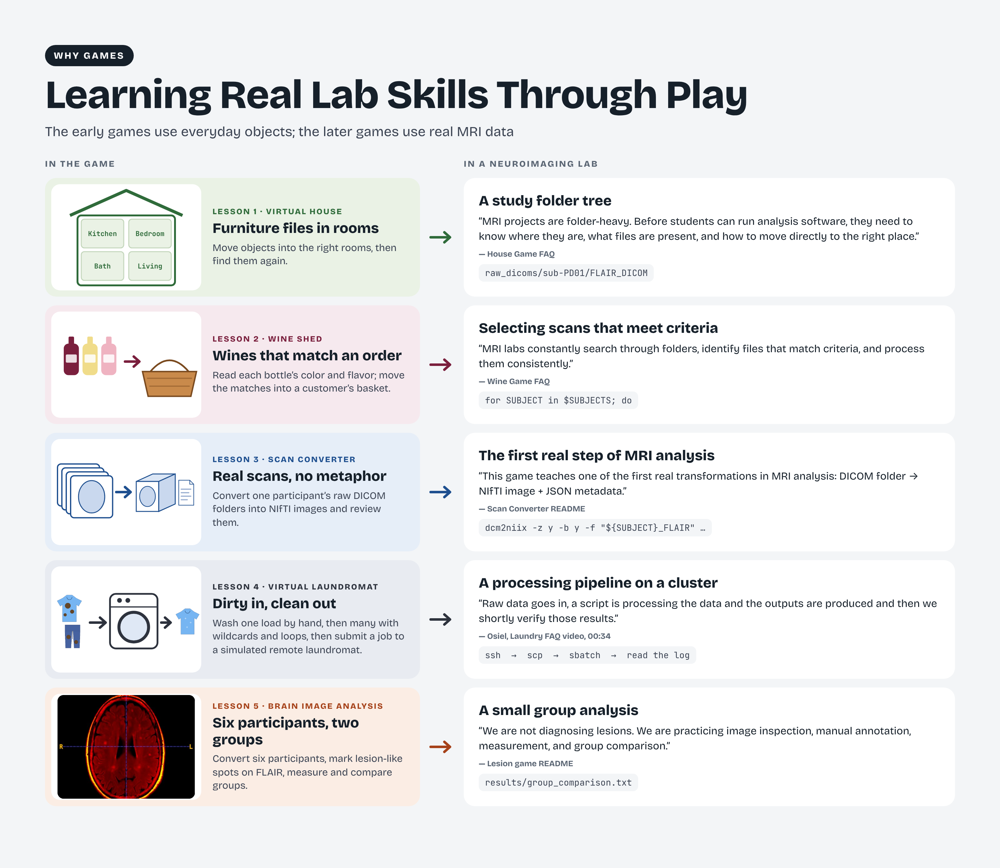
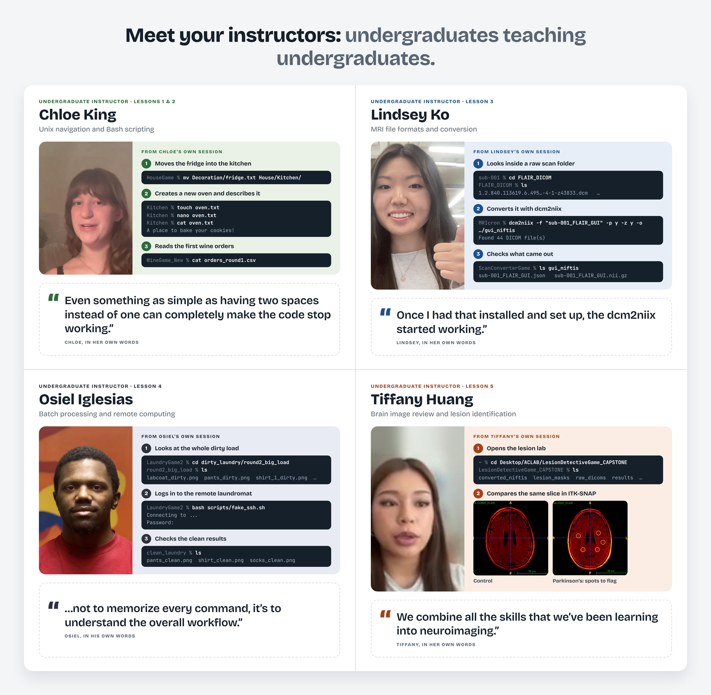

# About the project

## Project overview

Game-Based MRI Learning for Undergraduates introduces the computing skills used in MRI research through five practical learning activities developed with undergraduate students. The sequence moves from navigating files to writing scripts, converting scans, organizing repeated processing, and inspecting brain images.

The curriculum is designed for students beginning the computational side of neuroimaging. Instructors and laboratory mentors can use the materials to support introductory training and discussion.

## Why MRI research education matters

MRI research brings together scientific questions, image acquisition, data organization, and computational analysis. Before students can contribute to an MRI project, they need to locate the correct files, understand the input format, run an appropriate tool, and check what it produced. These practical steps help students connect their interest in neuroscience with the everyday work of a research laboratory.

## The challenge for undergraduate researchers

Many students arrive with a strong interest in neuroscience, but few have experience with Terminal, scripts, or scientific software. Unfamiliar folders and error messages can make it difficult to distinguish a small setup problem from a conceptual error. These lessons give students concrete tasks and visible outputs to inspect as they learn through play. 

## Why game-based learning

Learning a new command is easier to approach when its purpose is clear. In these games, students move objects between rooms, fill customer orders, and process loads of laundry while practicing the file operations and scripting used in research. Each task produces something they can inspect, giving them a way to connect a command with its result and work through mistakes. The MRI lessons then bring those skills into a scientific setting, where students convert scans, inspect brain images, and consider what their outputs can tell them. The games are designed to make the first steps approachable while keeping the connection to laboratory work visible.

The activities connect approachable game tasks with the organization and processing of research data. File navigation, conditional sorting, scan conversion, repeated processing, and image review provide successive points of connection to MRI laboratory workflows.

## Curriculum and learning progression

The curriculum begins with file navigation and a first script in Lesson 1, then develops conditions and loops in Lesson 2. Lesson 3 applies those skills to MRI conversion. Lesson 4 extends repeated processing to batches and simulated remote work. In Lesson 5, students combine these skills to prepare, inspect, annotate, and compare brain images.

## Reflection and peer support

Recording a reflection gives students practice explaining what they did, what challenged them, and how they worked through a problem. These accounts can help the next group of learners recognize difficulties and consider approaches they might try. Instructional recordings demonstrate procedures; reflection recordings describe the learner’s experience. Each lesson provides a clearly labeled place for both.

## Associated research and team

This repository accompanies Game-Based Learning for Hands-On Magnetic Resonance Imaging Education in Undergraduates.

The instructional recordings feature Chloe King, Lindsey Ko, Osiel Iglesias, and Tiffany Huang. Chloe King teaches Lessons 1 and 2; Lindsey Ko teaches Lesson 3; Osiel Iglesias teaches Lesson 4; Tiffany Huang teaches Lesson 5. Senegal Alfred Mabry maintains the curriculum and repository. The manuscript’s complete bibliographic details will be added when available.

Undergraduate contributors Chloe King, Lindsey Ko, Osiel Iglesias, and Tiffany Huang demonstrate the lesson workflows and explain common challenges. Their instructional recordings provide peer guidance alongside the written activities.
