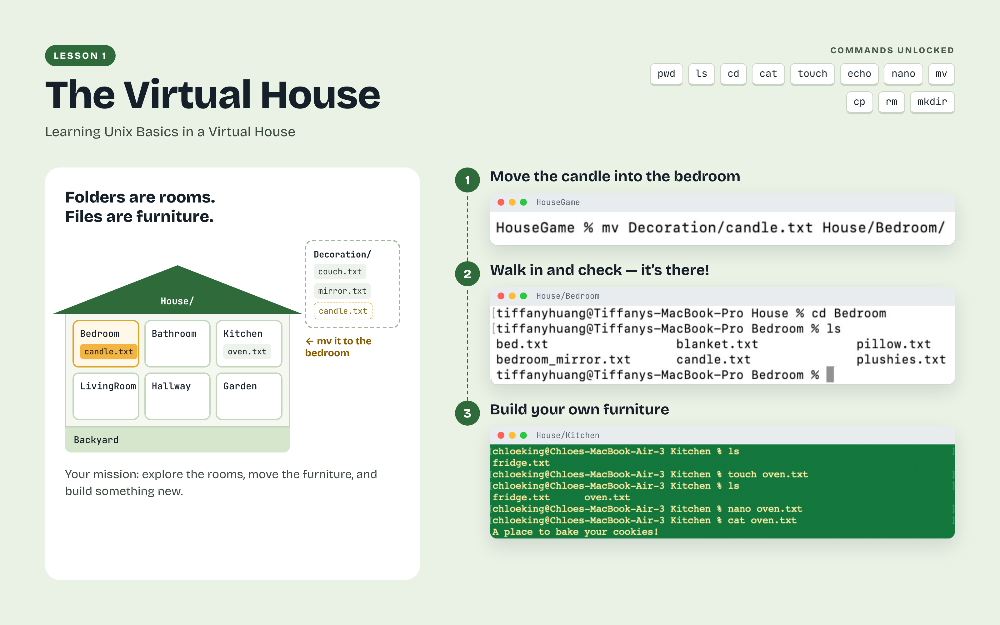
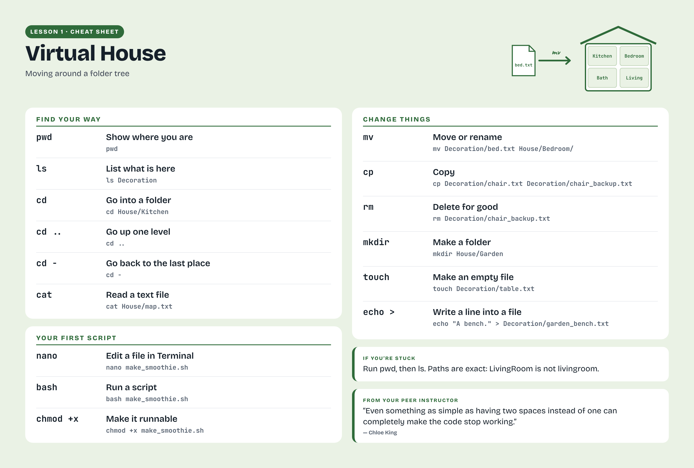
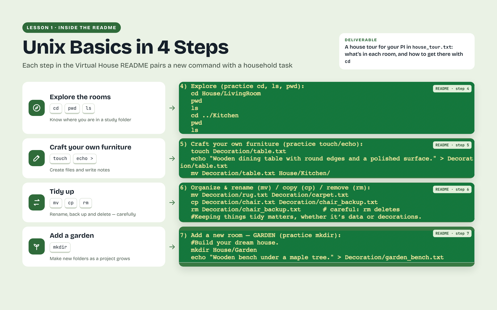
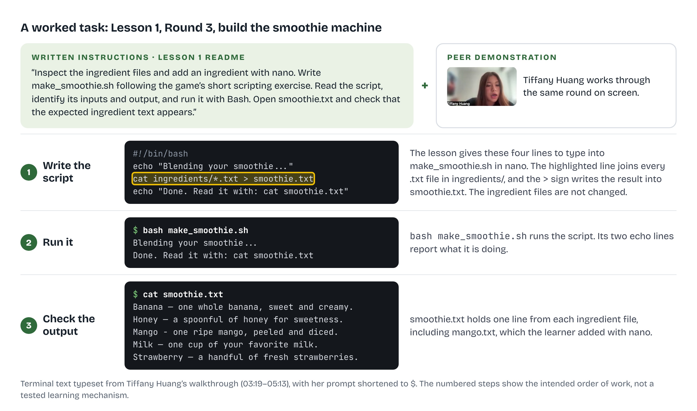

# Learning Unix Basics in a Virtual House

[All lessons](../README.md) · [Getting started](../getting-started.md) · [Instructional videos](videos.md) · [Student reflections](reflection-gallery.md) · [Troubleshooting](troubleshooting.md)

## Learning objectives

By the end of this lesson, you should be able to find your current directory, move between folders, inspect and edit text files, explain relative and absolute paths, and run a short Bash script. These skills will help you locate study files, organize your work, and understand where a research program reads its inputs and saves its results.

## The challenge

Supporting research begins with understanding where files are stored and how they relate to one another. In this lesson, you explore that idea by building and navigating a virtual house. Rooms are folders and objects are files. Use Terminal to inspect the house, move its contents, and make changes you can verify. In the final round, combine ingredient files into a smoothie with your first script.

Lesson 1 uses a virtual house to introduce Unix file operations. Rooms represent directories and objects represent files, allowing students to practice navigation, file manipulation, and checking the results of commands in a familiar setting.

## Download and open this lesson

[Download the lesson ZIP](https://github.com/SenegalAlfredMabry-ui/Game-Based-MRI-Learning-for-Undergraduates/releases/download/v0.1.0/Learning-Unix-Basics-in-a-Virtual-House.zip) · [Browse the game files](Learning-Unix-Basics-in-a-Virtual-House/)

Run `bash setup_Learning-Unix-Basics-in-a-Virtual-House.sh` from the downloaded folder, then enter the newly generated `Learning-Unix-Basics-in-a-Virtual-House` folder.

Screenshots and recordings may show earlier folder names. Use the folder names and commands in the current written instructions.

## Before you start

Complete Getting Started. You need Bash and a text editor; MRI software is not required. Read the setup script and run the supplied setup_Learning-Unix-Basics-in-a-Virtual-House.sh from the folder containing it. Enter the generated Learning-Unix-Basics-in-a-Virtual-House folder and read README.txt.

## Lesson cheat sheet

Lesson 1 reference sheet: commands and checks used in Learning Unix Basics in a Virtual House.

[Open the lesson reference sheet](../../assets/figures/Learning-Unix-Basics-in-a-Virtual-House-Reference-Sheet.png) · [Download a printable PDF](../../assets/figures/Learning-Unix-Basics-in-a-Virtual-House-Reference-Sheet.pdf)

Examples from Lesson 1 connect common Unix commands with visible changes in the virtual house. Students inspect directories, create and move files, and verify the results as they complete the activity.

## Round 1 Explore and change the house

Inspect the rooms and their contents with ls and cat. Move into a room with cd and use pwd to confirm your location. Follow the game’s tasks to move furnishings, rename or copy files, create new objects, and add a garden. After each operation, list the relevant directory and check what changed.

Use rm only when you understand which practice file it will remove. Keep your work inside the extracted game folder.

## Round 2 Move with paths

Use relative paths to reach nearby rooms and absolute paths to reach a room from elsewhere. Set the house path using your own extracted folder location. Practice reading a file without first changing into its directory. Use cd - to return to the previous directory and explain how that differs from moving to the parent directory.

## Round 3 Build the smoothie machine

Inspect the ingredient files and add an ingredient with nano. Write make_smoothie.sh following the game’s short scripting exercise. Read the script, identify its inputs and output, and run it with Bash. Open smoothie.txt and check that the expected ingredient text appears.

Compare running a script with bash and making it executable with chmod +x. The useful result is a readable smoothie file whose contents you can explain.

### Writing and checking your first script

The smoothie task introduces Bash scripting through a familiar idea: combining ingredients. Alongside the written instructions, Tiffany Huang demonstrates how to write `make_smoothie.sh`, run it, and inspect the resulting `smoothie.txt` file. The script combines the contents of the ingredient files without changing those inputs. Checking the output completes the task by confirming that the expected ingredient text appears.

[Open full-size figure](../../assets/figures/Figure-1b-A-Worked-Task-Build-the-Smoothie-Machine.png) · [Download PDF](../../assets/figures/Figure-1b-A-Worked-Task-Build-the-Smoothie-Machine.pdf) · [Download SVG](../../assets/figures/Figure-1b-A-Worked-Task-Build-the-Smoothie-Machine.svg)

## Check your work and what to keep

Keep your house tour, created objects, make_smoothie.sh, smoothie.txt, and round reflections. Check the destination of each moved file and the contents of the final smoothie. If a command succeeds but the expected file is elsewhere, use pwd and the paths in your command to explain why.

## Watch and reflect

The Lesson 1 instructional videos introduce the folder structure, demonstrate basic operations, and answer common questions. Use the written instructions for the path and smoothie rounds. Open Student Reflections for this lesson after completing your own attempt.

## Next lesson

Continue to Lesson 2 to turn file inspection and editing into a repeated sorting task.

[Continue to Lesson 2](../02-learning-bash-scripting-by-sorting-a-wine-shed/README.md)
