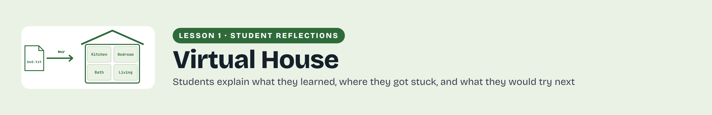

# Student reflections

Students reflect on their experience with Learning Unix Basics in a Virtual House, including the checks and decisions that shaped their work.

[Download a printable PDF](../../assets/figures/Learning-Unix-Basics-in-a-Virtual-House-Reflection-Gallery-Header.pdf)

## Learning Unix Basics in a Virtual House

Hear how other students approached this lesson, the problems they worked through, and the connections they made to MRI research. Their reflections offer examples to consider as you explain your own experience and decide what you would do next time.

Student reflection videos for this lesson are coming soon. Use the shared questions to prepare your own recording after completing the activity.

[Return to lesson](README.md) · [Prepare your reflection video](reflection.md)
