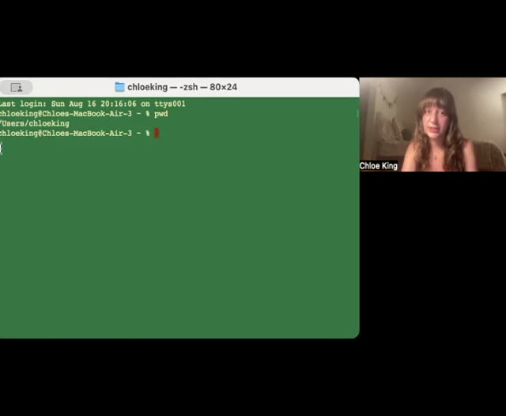
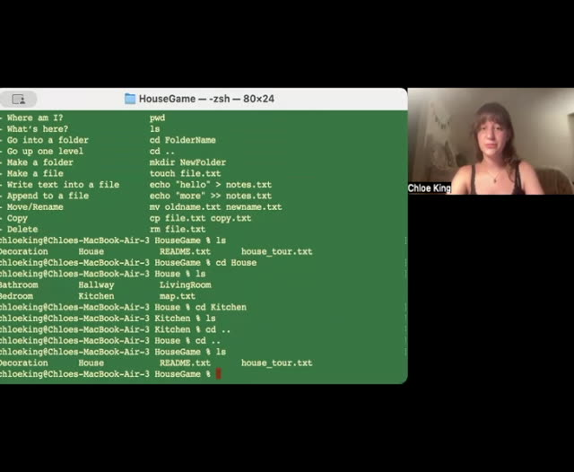
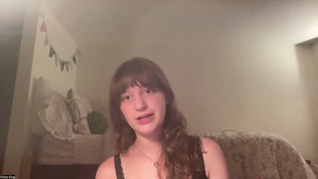

# Instructional videos

## Learning Unix Basics in a Virtual House

Use these recordings alongside the written instructions. Pause to try each step and inspect the outputs. The recordings show earlier folder names; use the current names in the written instructions.

### Finding your way around the house

[Watch video](../../assets/videos/Learning-Unix-Basics-in-a-Virtual-House-01.mp4) · [Transcript draft](../../assets/transcripts/Learning-Unix-Basics-in-a-Virtual-House-01.md)

### Working with rooms and objects

[Watch video](../../assets/videos/Learning-Unix-Basics-in-a-Virtual-House-02.mp4) · [Transcript draft](../../assets/transcripts/Learning-Unix-Basics-in-a-Virtual-House-02.md)

### Common questions

[Watch video](../../assets/videos/Learning-Unix-Basics-in-a-Virtual-House-03.mp4) · [Transcript draft](../../assets/transcripts/Learning-Unix-Basics-in-a-Virtual-House-03.md)

[Student reflections](reflection-gallery.md) · [Return to lesson](README.md)
