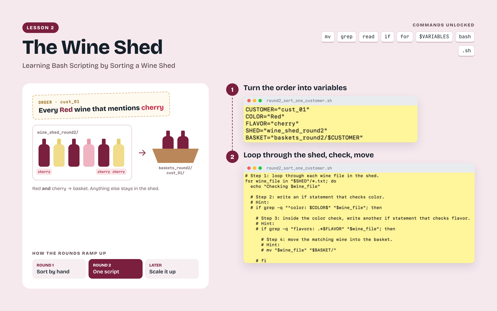
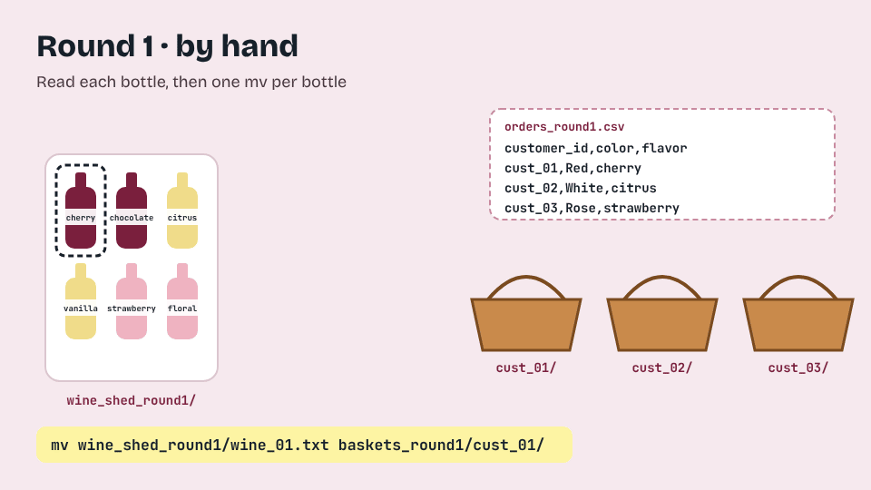
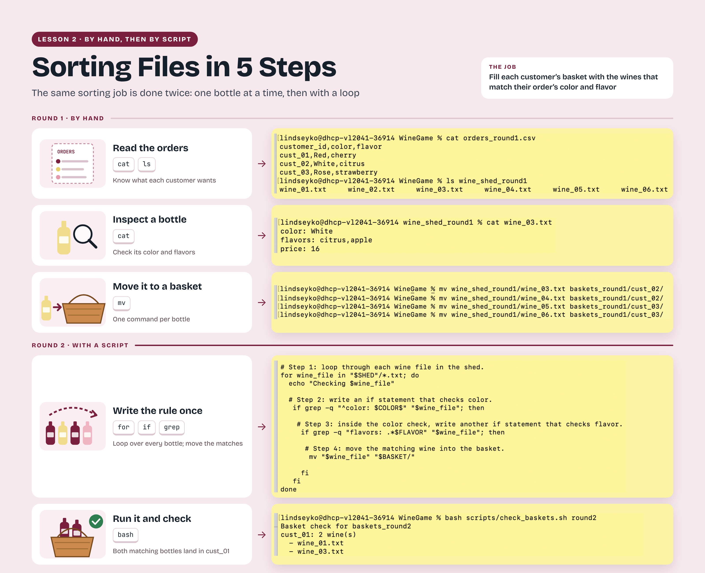

# Learning Bash Scripting by Sorting a Wine Shed

[All lessons](../README.md) · [Getting started](../getting-started.md) · [Instructional videos](videos.md) · [Student reflections](reflection-gallery.md) · [Troubleshooting](troubleshooting.md)

## Learning objectives

By the end of this lesson, you should be able to read information from files, match more than one condition, and use variables and loops to repeat a sorting task. You will also check that each file reached the correct destination. In a laboratory, the same skills help you select scans or participants that meet a study’s criteria and apply a consistent process across many files.

## The challenge

Researchers often need to apply the same decision to many files, which is why we write scripts. In this lesson, you fill customer orders by selecting matching wine files and placing them into basket folders. Begin by reading and moving individual files, then express the same decisions in a script that can handle several orders. You do not need to be a sommelier to play; the information you need is written in the files.

Lesson 2 introduces Bash scripting through a file-sorting task. Students translate customer orders into conditions, use variables and loops to identify matching wine files, and check that the selected files reach the correct baskets.

## Download and open this lesson

[Download the lesson ZIP](https://github.com/SenegalAlfredMabry-ui/Game-Based-MRI-Learning-for-Undergraduates/releases/download/v0.1.0/Learning-Bash-Scripting-by-Sorting-a-Wine-Shed.zip) · [Browse the game files](Learning-Bash-Scripting-by-Sorting-a-Wine-Shed/)

Run `bash setup_Learning-Bash-Scripting-by-Sorting-a-Wine-Shed.sh` from the downloaded folder, then enter the newly generated `Learning-Bash-Scripting-by-Sorting-a-Wine-Shed` folder.

Screenshots and recordings may show earlier folder names. Use the folder names and commands in the current written instructions.

## Before you start

Complete Lesson 1 — Learning Unix Basics in a Virtual House, including its scripting round. For Lesson 2 — Learning Bash Scripting by Sorting a Wine Shed, run the supplied setup_Learning-Bash-Scripting-by-Sorting-a-Wine-Shed.sh setup script according to the download instructions. Read the generated README and identify the order files, wine folders, basket folders, student templates, scripts, and instructor notes.

[Open the lesson reference sheet](../../assets/figures/Learning-Bash-Scripting-by-Sorting-a-Wine-Shed-Reference-Sheet.png) · [Download a printable PDF](../../assets/figures/Learning-Bash-Scripting-by-Sorting-a-Wine-Shed-Reference-Sheet.pdf)

Sorting files by hand and with repeated commands.

## Round 1 Sort by hand

Read the orders and inspect the attributes in each wine file. Match the requested color and flavor before moving a file. Inspect each basket after the move. A successful move alone does not establish that you chose the correct wine.

The sorting workflow moves from reading an order and inspecting individual files to expressing the same decisions in a Bash loop. Students check both the matching conditions and the destination baskets to determine whether the script performed the intended task.

## Round 2 Write a sorting script

Open the supplied template. Identify the variables for the order, the condition that checks the wine’s attributes, and the destination basket. Complete the loop so it examines the relevant files and moves a file only when the conditions match. Quote paths and variable expansions as directed by the lesson.

Run the script and check the baskets. When a result differs from your expectation, inspect the condition and the input text before adding more commands.

## Round 3 Handle several orders

Read each order and reuse the same decision process. Check all destination baskets. Consider what changes for each customer and what remains the same across the loop.

## Round 4 Try a new dataset

Generate the next dataset using the game’s instructions. Inspect the new files and orders before running your adapted script. A script that depends on one remembered filename may not work when the inputs change. Check its behavior on the generated data.

## Check your work and what to keep

Use scripts/check_baskets.sh with the round argument specified in the game. Inspect its output and compare it with the order files. Keep the completed scripts, basket outputs, and reflection notes. Keep a fresh setup available for another attempt rather than inventing a reset command.

## Watch and reflect

Watch the instructional recordings to see how the order files, wine files, and baskets relate to one another. Follow the written instructions as you turn the manual sorting steps into a script, and return to Common Challenges when a result does not match an order. After checking your work, use the shared reflection questions to explain in a video what changed when you began automating the task.

## Next lesson

Continue to Lesson 3 to apply scripting to real MRI file conversion.

[Continue to Lesson 3](../03-getting-hands-on-with-mri-1-converting-dicom-to-nifti/README.md)
