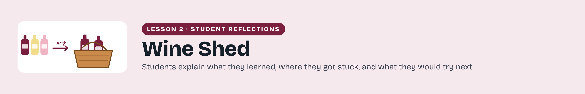
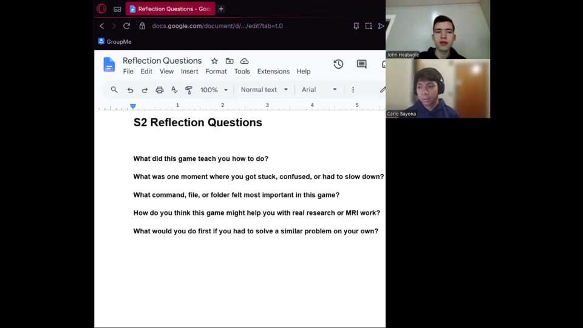

# Student reflections

Students reflect on their experience with Learning Bash Scripting by Sorting a Wine Shed, including the checks and decisions that shaped their work.

[Download a printable PDF](../../assets/figures/Learning-Bash-Scripting-by-Sorting-a-Wine-Shed-Reflection-Gallery-Header.pdf)

## Learning Bash Scripting by Sorting a Wine Shed

Hear how other students approached this lesson, the problems they worked through, and the connections they made to MRI research. Their reflections offer examples to consider as you explain your own experience and decide what you would do next time.

### John Heatwole and Carlo Bayona

Student reflection · 5:56

John and Carlo look back on their first experience learning Bash scripting through the Wine Shed. They discuss the parts they found challenging, including writing conditions and loops, and explain how breaking the task into smaller steps helped them work through it.

[Watch reflection](watch-Learning-Bash-Scripting-by-Sorting-a-Wine-Shed-Reflection.md) · [Transcript draft](../../assets/transcripts/Learning-Bash-Scripting-by-Sorting-a-Wine-Shed-Reflection.md)

[Return to lesson](README.md) · [Prepare your reflection video](reflection.md)
