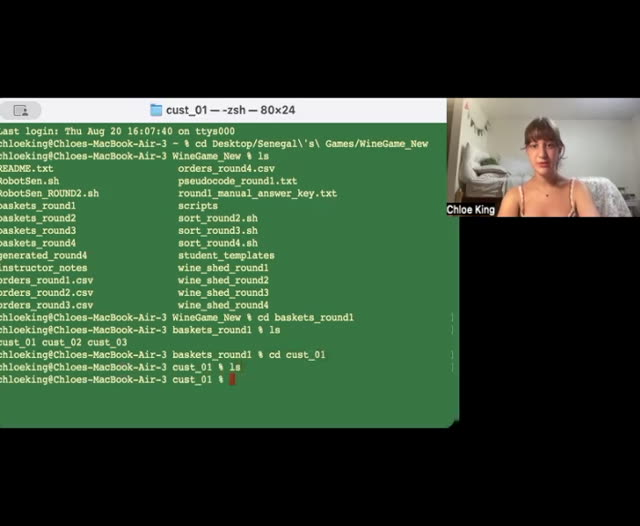
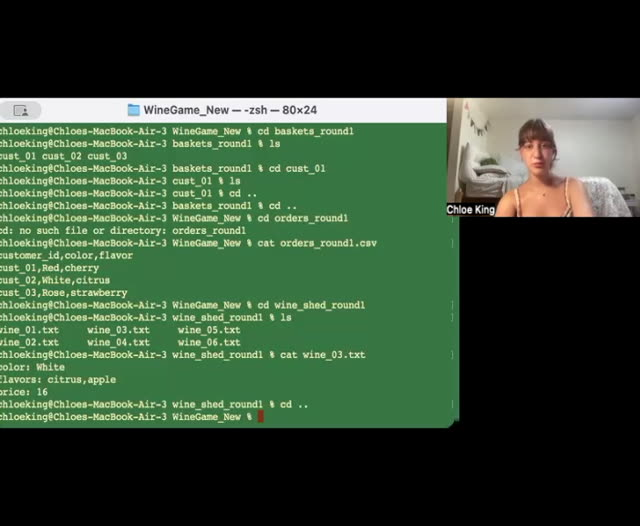
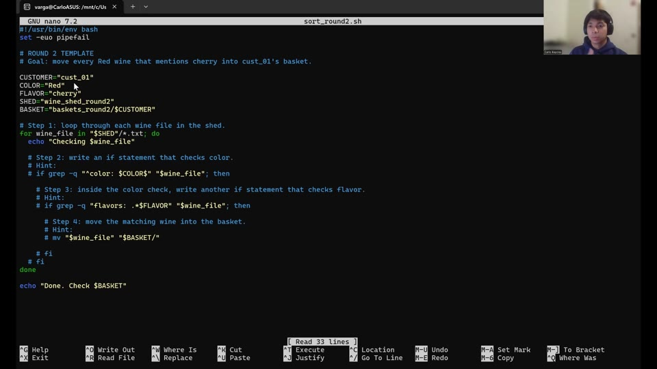

# Instructional videos

## Learning Bash Scripting by Sorting a Wine Shed

Use these recordings alongside the written instructions. Pause to try each step and inspect the outputs. The recordings show earlier folder names; use the current names in the written instructions.

### Understanding the wine shed

[Watch video](watch-Learning-Bash-Scripting-by-Sorting-a-Wine-Shed-01.md) · [Transcript draft](../../assets/transcripts/Learning-Bash-Scripting-by-Sorting-a-Wine-Shed-01.md)

### Sorting an order by hand

[Watch video](watch-Learning-Bash-Scripting-by-Sorting-a-Wine-Shed-02.md) · [Transcript draft](../../assets/transcripts/Learning-Bash-Scripting-by-Sorting-a-Wine-Shed-02.md)

### Common questions

[Watch video](watch-Learning-Bash-Scripting-by-Sorting-a-Wine-Shed-03.md) · [Transcript draft](../../assets/transcripts/Learning-Bash-Scripting-by-Sorting-a-Wine-Shed-03.md)

### Sort a Wine Shed order with a Bash script

Supplemental walkthrough · Carlo Bayona · 8:31

You have sorted a Wine Shed order by hand; now work through the Round 2 script with Carlo. He uses a loop to select wines that match the requested color and flavor, then checks the basket and reads the selected files to confirm the order.

[Watch walkthrough](watch-Learning-Bash-Scripting-by-Sorting-a-Wine-Shed-Supplemental-Walkthrough.md) · [Transcript draft](../../assets/transcripts/Learning-Bash-Scripting-by-Sorting-a-Wine-Shed-Supplemental-Walkthrough.md)

[Student reflections](reflection-gallery.md) · [Return to lesson](README.md)
