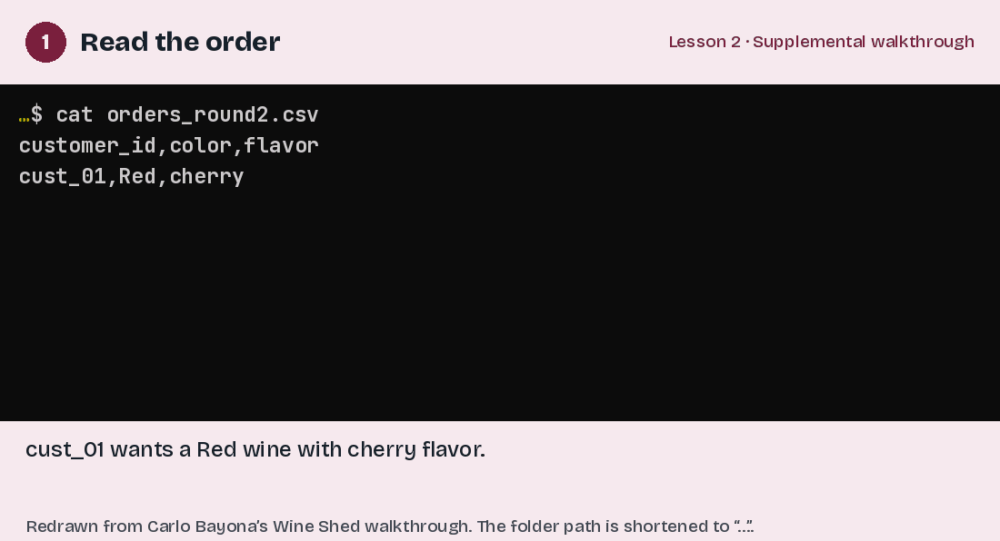

# Sort a Wine Shed order with a Bash script

Carlo Bayona · 8:31 · Windows WSL example

You have sorted a Wine Shed order by hand; now work through the Round 2 script with Carlo. He uses a loop to select wines that match the requested color and flavor, then checks the basket and reads the selected files to confirm the order.

[Download the full-quality video](../../assets/videos/Learning-Bash-Scripting-by-Sorting-a-Wine-Shed-Supplemental-Walkthrough.mp4) · [Transcript draft](../../assets/transcripts/Learning-Bash-Scripting-by-Sorting-a-Wine-Shed-Supplemental-Walkthrough.md)

https://github.com/user-attachments/assets/b056f676-6fb9-4407-be76-5d606846c1c3

### Check that the basket matches the order

After running the Wine Shed sorting script, Carlo Bayona checks the customer’s basket and opens a selected wine file. Comparing its color and flavor with the order shows why checking a result involves more than counting files. The animation redraws the commands and output from his walkthrough for readability.

[View still image](../../assets/figures/Learning-Bash-Scripting-by-Sorting-a-Wine-Shed-Check-the-Order-static.png) · [Open MP4](../../assets/figures/Learning-Bash-Scripting-by-Sorting-a-Wine-Shed-Check-the-Order.mp4)

## Using this example

Carlo uses WSL on Windows, with paths beginning in `/mnt/c`. Use the location of the lesson folder on your own computer.

To list the basket contents, run `bash scripts/check_baskets.sh round2` from the game folder. Then read the selected wine files to check that their attributes match the customer’s order.

[Return to lesson](README.md) · [Instructional videos](videos.md)
