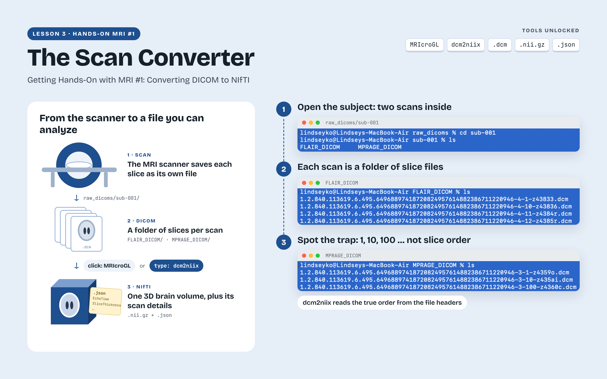
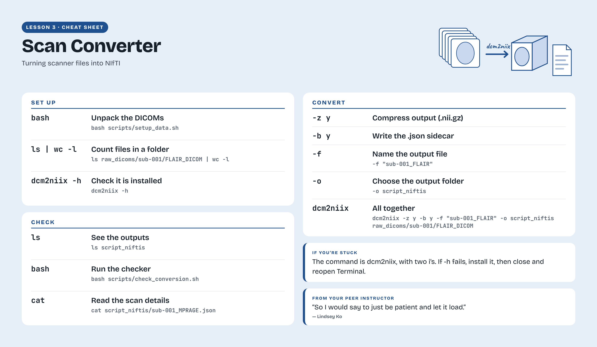
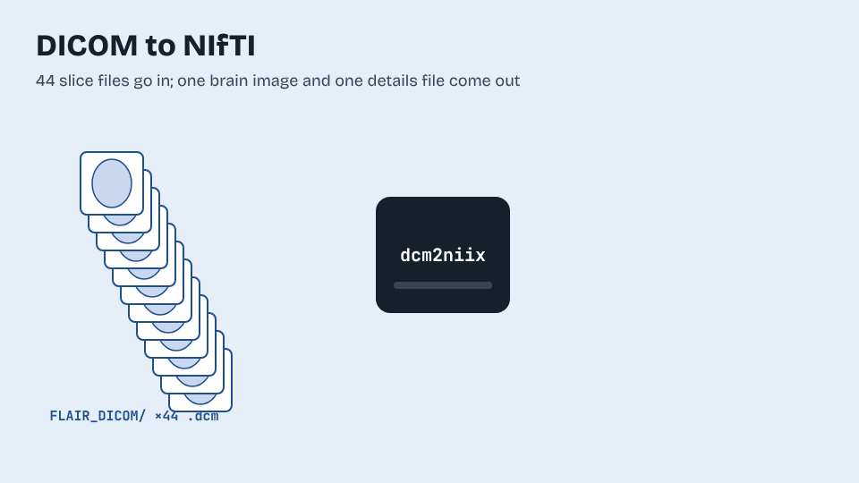
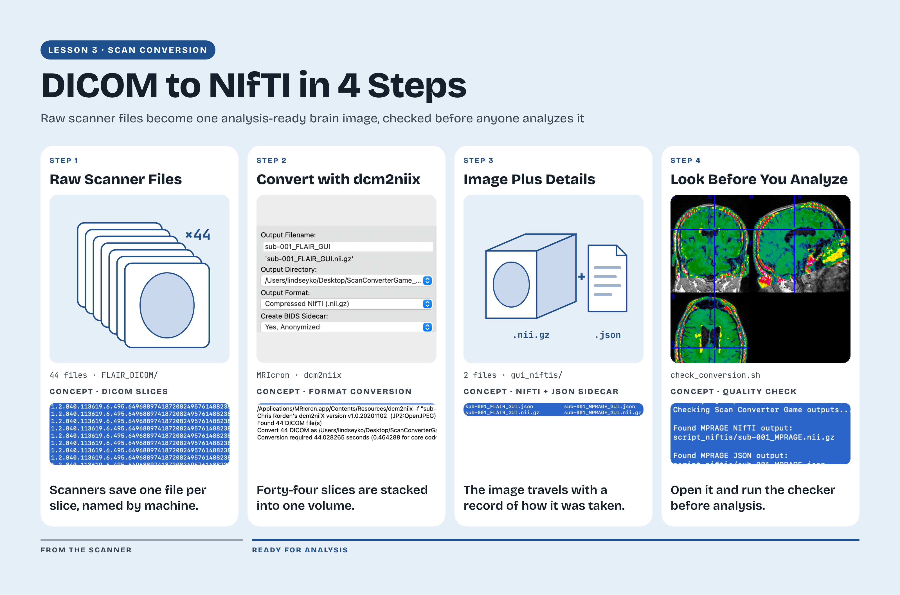

# Getting Hands-On with MRI #1: Converting DICOM to NIfTI

[All lessons](../README.md) · [Getting started](../getting-started.md) · [Instructional videos](videos.md) · [Student reflections](reflection-gallery.md) · [Troubleshooting](troubleshooting.md)

## Learning objectives

By the end of this lesson, you should be able to explain how a DICOM scan series differs from a NIfTI image, convert scans through a graphical interface and a script, and inspect the resulting images and metadata. This prepares you to take scanner output into a research workflow while checking that the correct scan and acquisition details have been retained.

## The challenge

MRI scanners commonly save images in DICOM, a format that stores image data together with information about the scan. Many research tools use NIfTI, a format designed for neuroimaging analysis. In this lesson, you convert the same teaching scans through two routes and compare the outputs. MRIcron is a brain-image viewer used with the graphical conversion workflow in the lesson. dcm2niix is a conversion program that reads DICOM data and produces NIfTI images, with optional JSON files containing acquisition details. You will call dcm2niix from a short script and keep the two routes’ outputs in separate folders.

Software references: MRIcron — https://www.nitrc.org/projects/mricron ; dcm2niix — https://github.com/rordenlab/dcm2niix

Lesson 3 introduces the organization of scanner output and the conversion of DICOM series into NIfTI images. The examples connect scan folders with their image files and show why filenames alone do not determine slice order.

## Download and open this lesson

[Download the lesson ZIP](https://github.com/SenegalAlfredMabry-ui/Game-Based-MRI-Learning-for-Undergraduates/releases/download/v0.1.0/Getting-Hands-On-with-MRI-1-Converting-DICOM-to-NIfTI.zip) · [Browse the game files](Getting-Hands-On-with-MRI-1-Converting-DICOM-to-NIfTI/)

Read `README.txt` and follow the numbered instruction files.

Screenshots and recordings may show earlier folder names. Use the folder names and commands in the current written instructions.

## Before you start

Check Bash, unzip, MRIcron, and dcm2niix. Extract the lesson and read instructions/Part_1_Packages_MRIcron_GUI_Review.txt. Locate raw_dicoms_zipped, raw_dicoms, scripts, and student_notes. Unpack the input scans as directed.

## Lesson cheat sheet

Lesson 3 reference sheet: commands and checks used in Getting Hands-On with MRI #1: Converting DICOM to NIfTI.

[Open the lesson reference sheet](../../assets/figures/Getting-Hands-On-with-MRI-1-Converting-DICOM-to-NIfTI-Reference-Sheet.png) · [Download a printable PDF](../../assets/figures/Getting-Hands-On-with-MRI-1-Converting-DICOM-to-NIfTI-Reference-Sheet.pdf)

DICOM inputs pass through conversion to produce a NIfTI image and JSON metadata.

## Part 1 Convert and inspect through MRIcron

The lesson uses two types of MRI scan. MPRAGE stands for magnetization-prepared rapid acquisition gradient echo; here it produces a T1-weighted image that helps distinguish brain tissues and inspect anatomy. FLAIR stands for fluid-attenuated inversion recovery; it suppresses the signal from cerebrospinal fluid so certain bright tissue abnormalities can be easier to see. Create gui_niftis, then convert both inputs using the lesson’s MRIcron instructions. Rename the outputs to sub-001_MPRAGE_GUI.nii.gz and sub-001_FLAIR_GUI.nii.gz. Inspect each image separately, adjust display contrast, and then review the overlay described in the lesson.

Check that both files belong to the intended subject and scan types. Displaying two images together does not itself establish that they are spatially aligned.

The conversion workflow links DICOM input files, a dcm2niix command, and the resulting NIfTI image and JSON metadata. Students inspect the image and check the outputs before continuing to analysis. The file count shown belongs to the illustrated teaching series.

## Part 2 Convert with a script

Read instructions/Part_2_Command_Line_DICOM_to_NIfTI_Script.txt. Create script_niftis and complete the conversion script. Identify the input directory, output directory, filename pattern, and options in each dcm2niix command. Adapt the MPRAGE conversion for FLAIR, then run and inspect the results.

The scripted outputs are sub-001_MPRAGE.nii.gz, sub-001_MPRAGE.json, sub-001_FLAIR.nii.gz, and sub-001_FLAIR.json. The JSON files contain acquisition metadata. Read the fields used by the lesson without sharing identifying fields in public posts.

## Check your work and what to keep

Keep the GUI images, scripted images and JSON files, conversion script, and conversion_questions.txt notes. Use the provided conversion check and inspect both output folders yourself. The scripted check does not replace inspection of the GUI outputs.

## Student reflections

Lindsey — Converting scans and checking outputs — 2:04.

Lindsey explains how she converted MPRAGE and FLAIR scans by hand and with a script. She describes mistaking a slow conversion for a frozen screen, checking the gui_niftis and script_niftis folders, and choosing a script for repeated work.

[Watch Lindsey’s reflection](reflection-gallery.md) · [Read the transcript](../../assets/transcripts/Getting-Hands-On-with-MRI-1-Converting-DICOM-to-NIfTI-Reflection-Lindsey-Ko.md) · [Prepare your reflection video](reflection.md)

## Next lesson

Continue to Lesson 4 to practice larger batches and simulated remote processing.

[Continue to Lesson 4](../04-learning-remote-computing-in-a-virtual-laundromat/README.md)
