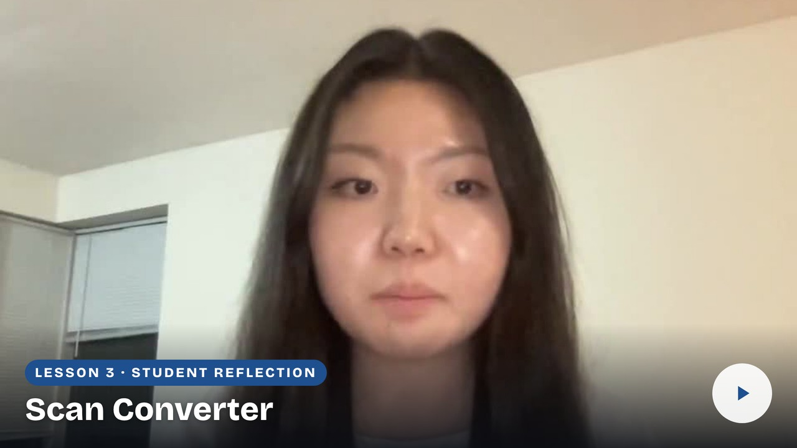

# Student reflections

## Getting Hands-On with MRI #1: Converting DICOM to NIfTI

Hear how other students approached this lesson, the problems they worked through, and the connections they made to MRI research. Their reflections offer examples to consider as you explain your own experience and decide what you would do next time.

## Lindsey Ko — Converting scans and checking outputs

Lindsey describes converting MPRAGE and FLAIR scans through MRIcron and a script. She explains why a slow conversion initially seemed frozen, how she used the output folders to check her work, and why she would automate the process for repeated scans.

[Return to lesson](README.md) · [Prepare your reflection video](reflection.md)

| Lindsey Ko — 2:04 |
| :--- |
|  |
| [Watch reflection](watch-Getting-Hands-On-with-MRI-1-Converting-DICOM-to-NIfTI-Reflection-Lindsey-Ko.md) · [Transcript draft](../../assets/transcripts/Getting-Hands-On-with-MRI-1-Converting-DICOM-to-NIfTI-Reflection-Lindsey-Ko.md) |
