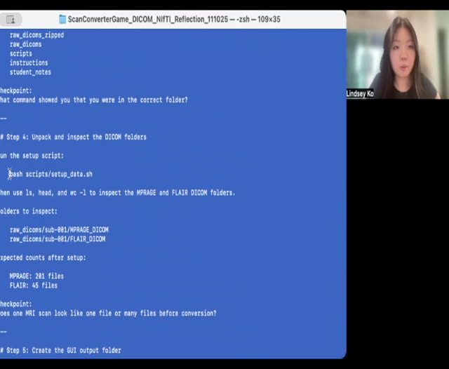
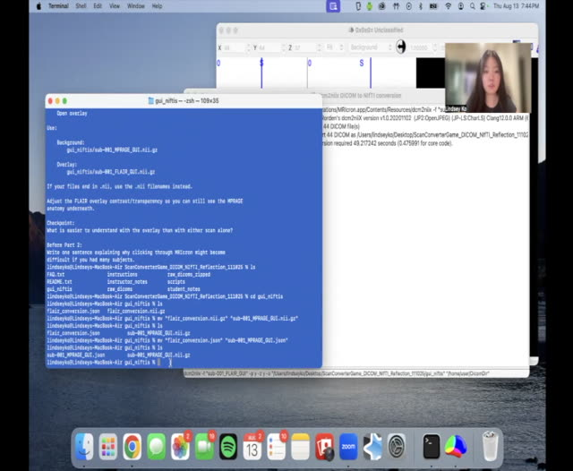
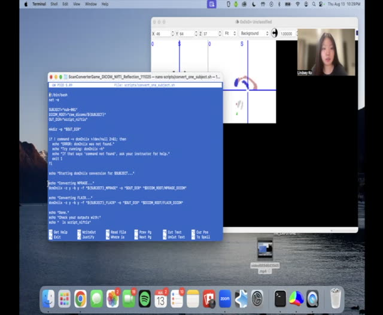
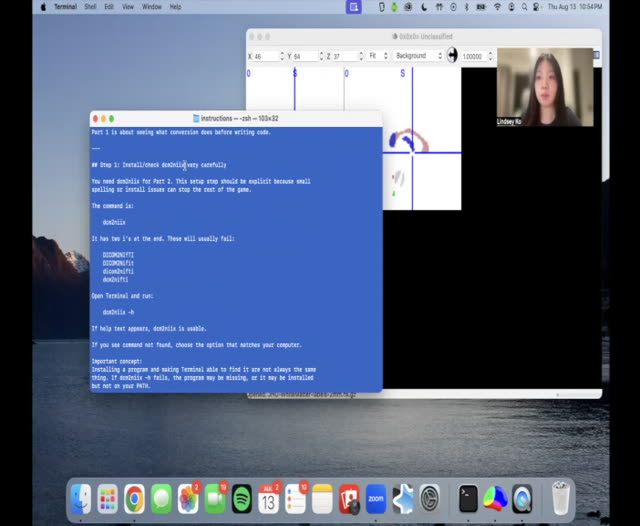

# Instructional videos

## Getting Hands-On with MRI #1: Converting DICOM to NIfTI

Use these recordings alongside the written instructions. Pause to try each step and inspect the outputs. The recordings show earlier folder names; use the current names in the written instructions.

### Preparing for scan conversion

[Watch video](../../assets/videos/Getting-Hands-On-with-MRI-1-Converting-DICOM-to-NIfTI-01.mp4) · [Transcript draft](../../assets/transcripts/Getting-Hands-On-with-MRI-1-Converting-DICOM-to-NIfTI-01.md)

### Converting and reviewing images through the graphical interface

[Watch video](../../assets/videos/Getting-Hands-On-with-MRI-1-Converting-DICOM-to-NIfTI-02.mp4) · [Transcript draft](../../assets/transcripts/Getting-Hands-On-with-MRI-1-Converting-DICOM-to-NIfTI-02.md)

### Converting images from the command line

[Watch video](../../assets/videos/Getting-Hands-On-with-MRI-1-Converting-DICOM-to-NIfTI-03.mp4) · [Transcript draft](../../assets/transcripts/Getting-Hands-On-with-MRI-1-Converting-DICOM-to-NIfTI-03.md)

### Common questions about conversion

[Watch video](../../assets/videos/Getting-Hands-On-with-MRI-1-Converting-DICOM-to-NIfTI-04.mp4) · [Transcript draft](../../assets/transcripts/Getting-Hands-On-with-MRI-1-Converting-DICOM-to-NIfTI-04.md)

[Student reflections](reflection-gallery.md) · [Return to lesson](README.md)
