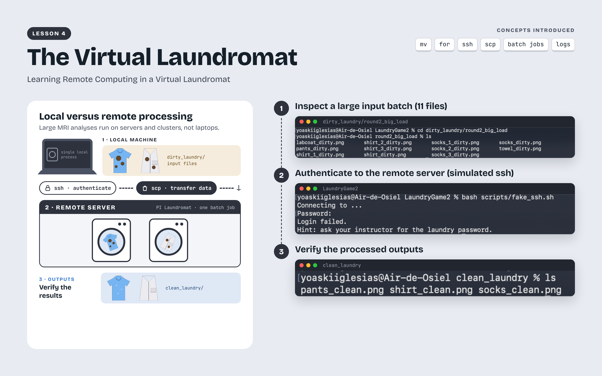
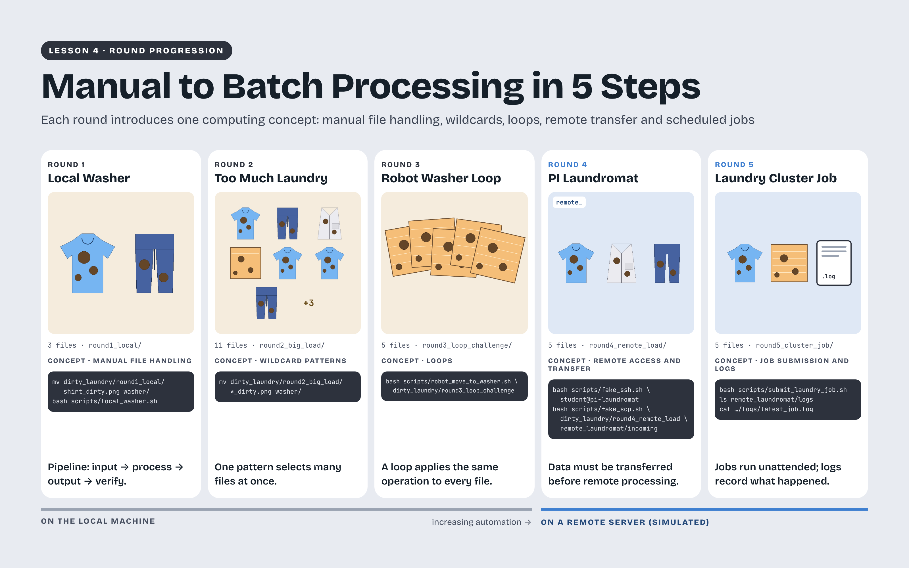
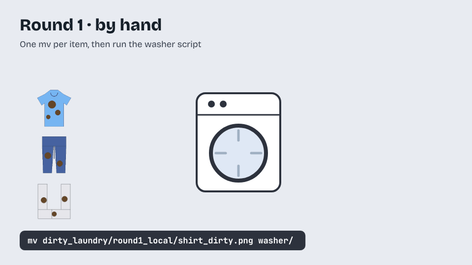

# Learning Remote Computing in a Virtual Laundromat

[All lessons](../README.md) · [Getting started](../getting-started.md) · [Instructional videos](videos.md) · [Student reflections](reflection-gallery.md) · [Troubleshooting](troubleshooting.md)

## Learning objectives

By the end of this lesson, you should be able to follow files from an input folder through processing to an output folder, use patterns and loops to handle a batch, and explain how local work differs from work on a remote computer. You will practice checking logs and outputs to determine whether a simulated job finished successfully. These habits become essential when research involves more scans than you can reasonably process one at a time.

## The challenge

An MRI study may contain several scans from each of many participants. Repeating every step by hand takes time and makes it harder to apply the same procedure consistently. This lesson uses a virtual laundromat to make that problem visible: a few clothing files are manageable individually, but a larger load calls for a repeatable workflow. You will move from local processing to batches and a simulation of remote access, file transfer, and job submission. The clothing files are ordinary PNG images, allowing you to learn the organization of these workflows before using them with research data.

Lesson 4 uses a virtual laundromat to introduce batch processing and remote-computing concepts. Students follow clothing files through transfer, processing, and output checks while a local simulation represents a remote system.

## Download and open this lesson

[Download the lesson ZIP](https://github.com/SenegalAlfredMabry-ui/Game-Based-MRI-Learning-for-Undergraduates/releases/download/v0.1.0/Learning-Remote-Computing-in-a-Virtual-Laundromat.zip) · [Browse the game files](Learning-Remote-Computing-in-a-Virtual-Laundromat/)

Read `README.txt` and follow the numbered instruction files.

Screenshots and recordings may show earlier folder names. Use the folder names and commands in the current written instructions.

## Before you start

Download and extract Lesson 4 — Learning Remote Computing in a Virtual Laundromat. The current package creates a Learning-Remote-Computing-in-a-Virtual-Laundromat folder. Read FAQ.txt and instructions/Part_0_Before_You_Start.txt, then locate dirty_laundry, original_dirty_laundry, washer, clean_laundry, scripts, remote_laundromat, and student_notes.

[Open the lesson reference sheet](../../assets/figures/Learning-Remote-Computing-in-a-Virtual-Laundromat-Reference-Sheet.png) · [Download a printable PDF](../../assets/figures/Learning-Remote-Computing-in-a-Virtual-Laundromat-Reference-Sheet.pdf)

The five rounds of Lesson 4 develop a workflow from individual file operations to repeated processing and simulated remote job submission. Each round asks students to identify the inputs, understand the processing step, and check the outputs.

Individual processing progresses to batch processing in the simulated laundromat.

## Round 1 Local washer

Inspect the inputs, the clothes, move the required items to the washer, run the local washer script, and run the checker. Open the resulting images and identify what changed.

## Round 2 Too much laundry

Inspect the larger load. Compare moving files individually with matching a group using a wildcard. Check which filenames the pattern includes before using it. Run the washer and inspect all expected outputs.

## Round 3 Robot washer loop

Read the loop helper and identify the input pattern. Run the robot loop check and process the batch as instructed. Explain what each repetition does and how you would recognize a skipped input.

## Round 4 PI Laundromat

Follow the simulated login and transfer steps. Identify which folder represents your local work and which represents the remote location. Run the remote-processing step and verify its outputs. These exercises run locally; they do not require institutional credentials or connect you to a real research server.

## Round 5 Submit a simulated cluster job

Prepare the inputs, submit the simulated job, and read its log. Compare the expected clean files with the actual outputs. A submission message tells you that the job was submitted; the outputs and log help you determine whether it completed as intended.

## Help and recovery

Try the guided round instructions first. If you need a more explicit step, open the matching file in instructions/stuck_instructions. Record the help you used in your reflection. Save work you want to keep before using the documented reset procedure, and distinguish a normal output reset from a full reset.

## Next lesson

Continue to Lesson 5 to combine these workflows with MRI inspection and measurement.

[Continue to Lesson 5](../05-getting-hands-on-with-mri-2-lesion-identification-in-parkinsons-disease-research-through-brain-image-analysis/README.md)
