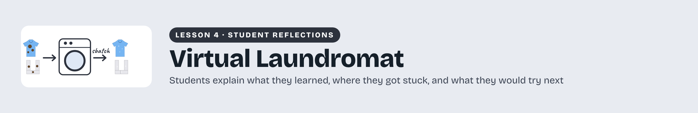
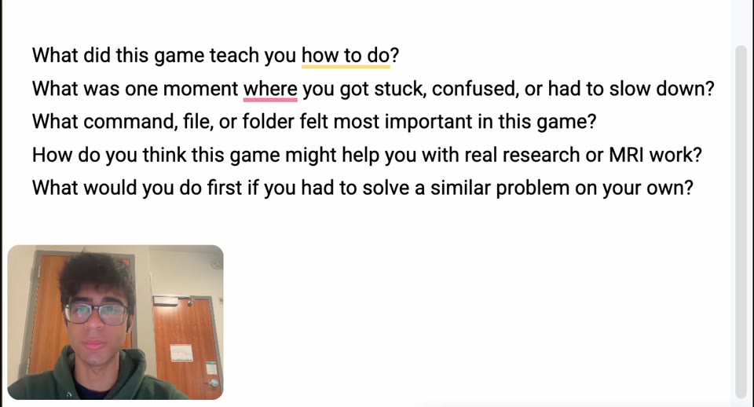

# Student reflections

Students reflect on their experience with Learning Remote Computing in a Virtual Laundromat, including the checks and decisions that shaped their work.

[Download a printable PDF](../../assets/figures/Learning-Remote-Computing-in-a-Virtual-Laundromat-Reflection-Gallery-Header.pdf)

## Learning Remote Computing in a Virtual Laundromat

Hear how other students approached this lesson, the problems they worked through, and the connections they made to MRI research. Their reflections offer examples to consider as you explain your own experience and decide what you would do next time.

### Aaryan Sajwani

Student reflection · 3:42

After completing the Virtual Laundromat, Aaryan shares what helped him make sense of the lesson. He discusses moving from individual file operations to loops and simulated remote work, and explains how reading logs and checking output folders helped him understand what happened after running a command.

[Watch reflection](watch-Learning-Remote-Computing-in-a-Virtual-Laundromat-Reflection.md) · [Transcript draft](../../assets/transcripts/Learning-Remote-Computing-in-a-Virtual-Laundromat-Reflection.md)

[Return to lesson](README.md) · [Prepare your reflection video](reflection.md)
