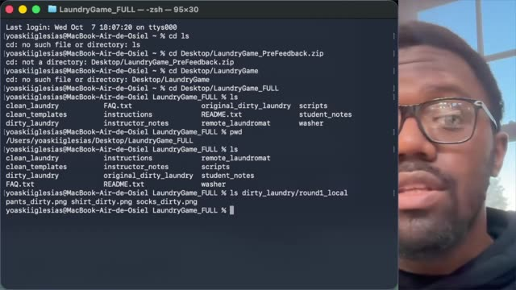
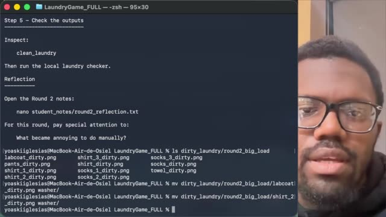
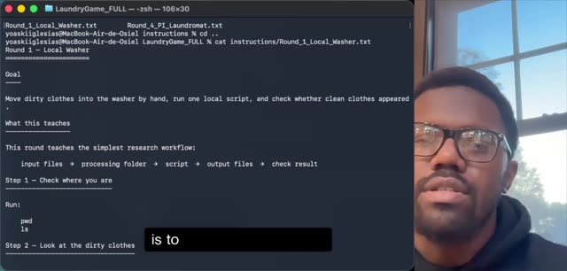

# Instructional videos

## Learning Remote Computing in a Virtual Laundromat

Use these recordings alongside the written instructions. Pause to try each step and inspect the outputs. The recordings show earlier folder names; use the current names in the written instructions.

### Following the laundry workflow

[Watch video](watch-Learning-Remote-Computing-in-a-Virtual-Laundromat-01.md) · [Transcript draft](../../assets/transcripts/Learning-Remote-Computing-in-a-Virtual-Laundromat-01.md)

### Continuing the laundry workflow

[Watch video](watch-Learning-Remote-Computing-in-a-Virtual-Laundromat-02.md) · [Transcript draft](../../assets/transcripts/Learning-Remote-Computing-in-a-Virtual-Laundromat-02.md)

### Common questions

[Watch video](watch-Learning-Remote-Computing-in-a-Virtual-Laundromat-03.md) · [Transcript draft](../../assets/transcripts/Learning-Remote-Computing-in-a-Virtual-Laundromat-03.md)

[Student reflections](reflection-gallery.md) · [Return to lesson](README.md)
