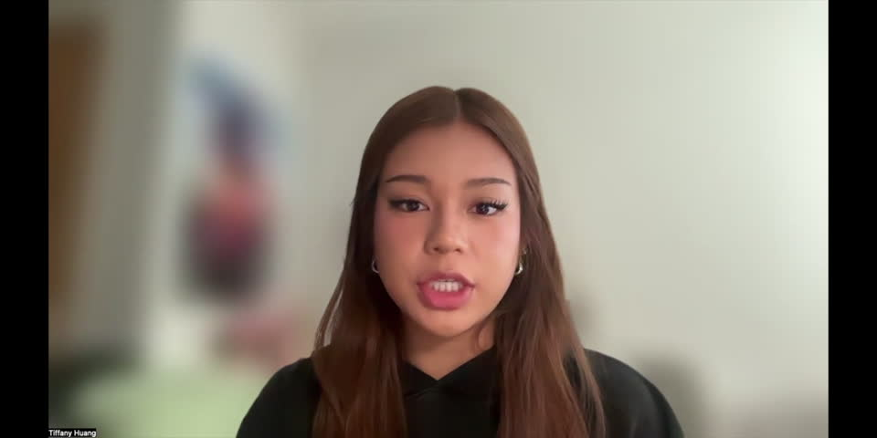

# Student reflections

## Getting Hands-On with MRI #2: Lesion Identification in Parkinson’s Disease Research Through Brain Image Analysis

Hear how other students approached this lesson, the problems they worked through, and the connections they made to MRI research. Their reflections offer examples to consider as you explain your own experience and decide what you would do next time.

## Tiffany Huang — Checking images and building research skills

Tiffany describes organizing MRI files, checking contrast and adjacent slices when marking candidate hyperintensities, and using the results folder to review her work. She reflects on how the earlier lessons helped her approach image analysis and why she would check her working directory before starting a similar task.

[Return to lesson](README.md) · [Prepare your reflection video](reflection.md)

| Tiffany Huang — 2:30 |
| :--- |
|  |
| [Watch reflection](watch-Getting-Hands-On-with-MRI-2-Lesion-Identification-in-Parkinsons-Disease-Research-Through-Brain-Image-Analysis-Reflection-Tiffany-Huang.md) · [Transcript draft](../../assets/transcripts/Getting-Hands-On-with-MRI-2-Lesion-Identification-in-Parkinsons-Disease-Research-Through-Brain-Image-Analysis-Reflection-Tiffany-Huang.md) |
