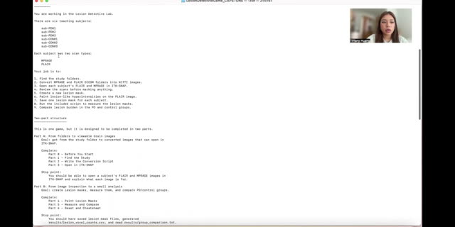
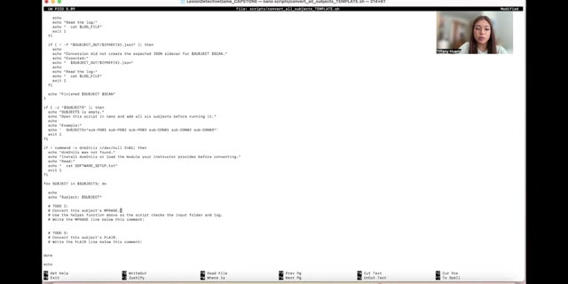
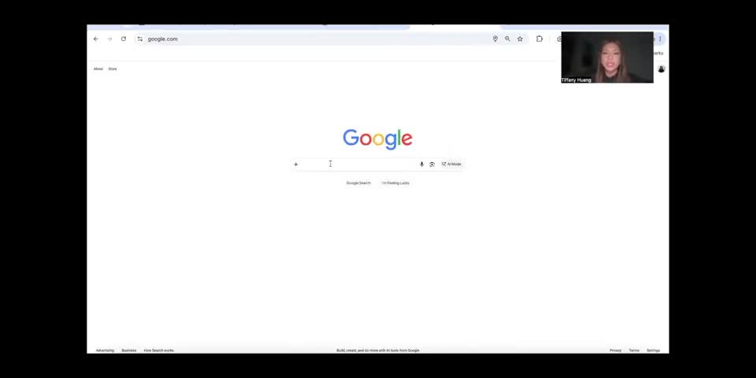

# Instructional videos

## Getting Hands-On with MRI #2: Lesion Identification in Parkinson’s Disease Research Through Brain Image Analysis

Use these recordings alongside the written instructions. Pause to try each step and inspect the outputs. The recordings show earlier folder names; use the current names in the written instructions.

### Preparing the capstone workflow

[Watch video](watch-Getting-Hands-On-with-MRI-2-Lesion-Identification-in-Parkinsons-Disease-Research-Through-Brain-Image-Analysis-01.md) · [Transcript draft](../../assets/transcripts/Getting-Hands-On-with-MRI-2-Lesion-Identification-in-Parkinsons-Disease-Research-Through-Brain-Image-Analysis-01.md)

### Working through image analysis

[Watch video](watch-Getting-Hands-On-with-MRI-2-Lesion-Identification-in-Parkinsons-Disease-Research-Through-Brain-Image-Analysis-02.md) · [Transcript draft](../../assets/transcripts/Getting-Hands-On-with-MRI-2-Lesion-Identification-in-Parkinsons-Disease-Research-Through-Brain-Image-Analysis-02.md)

### Tiffany Huang — Software setup and image review

[Watch video](watch-Getting-Hands-On-with-MRI-2-Lesion-Identification-in-Parkinsons-Disease-Research-Through-Brain-Image-Analysis-Common-Challenges-Tiffany-Huang.md) · [Transcript draft](../../assets/transcripts/Getting-Hands-On-with-MRI-2-Lesion-Identification-in-Parkinsons-Disease-Research-Through-Brain-Image-Analysis-Common-Challenges-Tiffany-Huang.md)

[Student reflections](reflection-gallery.md) · [Return to lesson](README.md)
