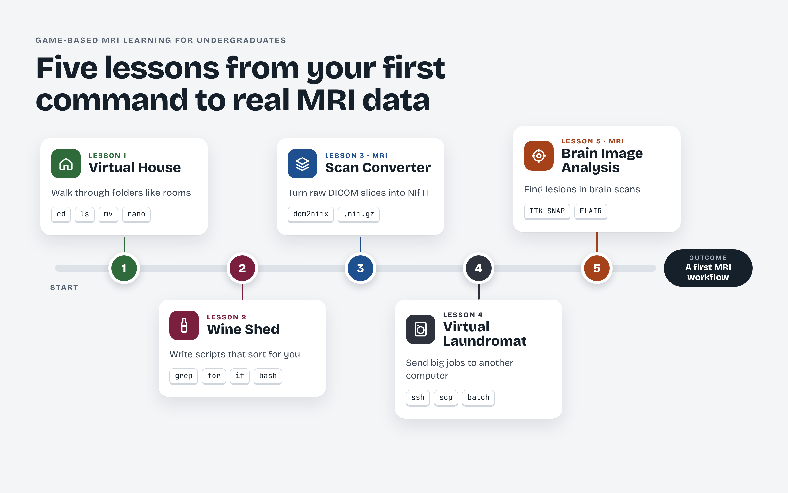
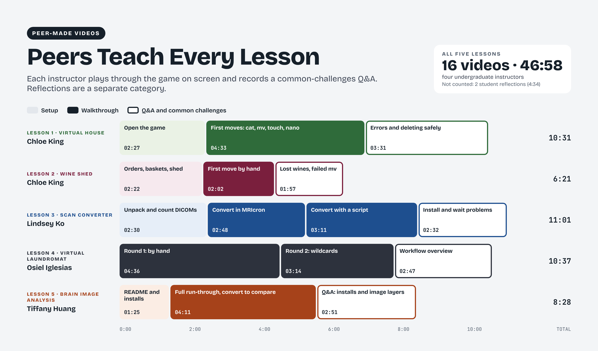

# Learning index

## Follow the five lessons

Work through Lessons 1–5 in order. Each lesson builds on earlier skills. You can return to the software guide, command reference, or troubleshooting pages at any point.

Within a lesson, start with the learning objectives and setup instructions, complete the activity, check your outputs, and prepare your reflection video using the shared questions. Watch the instructional recordings when a demonstration would help. Open that lesson’s reflection gallery to hear how other learners experienced the work.

- [Lesson 1 — Learning Unix Basics in a Virtual House](../02-learning-the-games/01-learning-unix-basics-in-a-virtual-house/README.md)
- [Lesson 2 — Learning Bash Scripting by Sorting a Wine Shed](../02-learning-the-games/02-learning-bash-scripting-by-sorting-a-wine-shed/README.md)
- [Lesson 3 — Getting Hands-On with MRI #1: Converting DICOM to NIfTI](../02-learning-the-games/03-getting-hands-on-with-mri-1-converting-dicom-to-nifti/README.md)
- [Lesson 4 — Learning Remote Computing in a Virtual Laundromat](../02-learning-the-games/04-learning-remote-computing-in-a-virtual-laundromat/README.md)
- [Lesson 5 — Getting Hands-On with MRI #2: Lesion Identification in Parkinson’s Disease Research Through Brain Image Analysis](../02-learning-the-games/05-getting-hands-on-with-mri-2-lesion-identification-in-parkinsons-disease-research-through-brain-image-analysis/README.md)

## Lesson sequence

The lesson sequence connects introductory Unix and Bash tasks with scan conversion, simulated remote processing, and a first brain-image analysis workflow.

## Instructional video series

Sixteen instructional recordings provide setup demonstrations, walkthroughs, and answers to common questions across the five lessons. Lindsey’s and Tiffany’s reflections are separate recordings, available in their respective lesson galleries. Durations are rounded.
