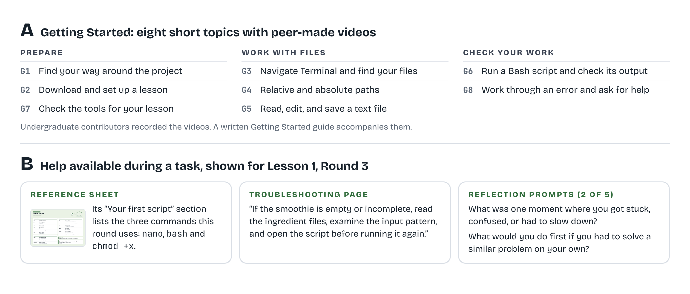
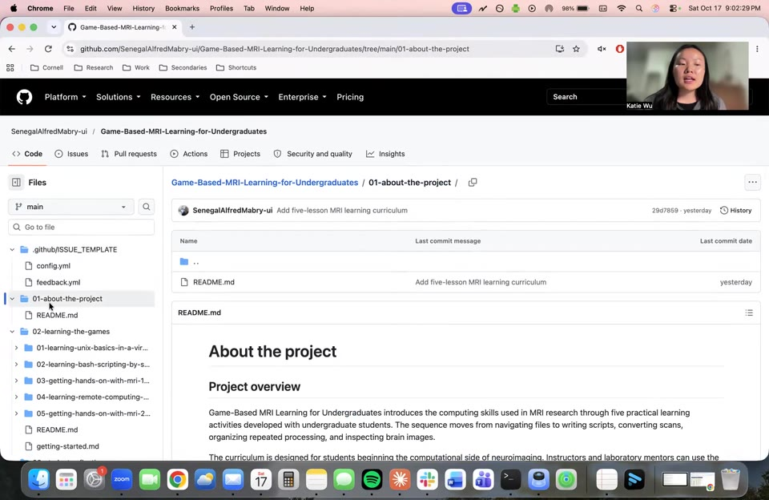
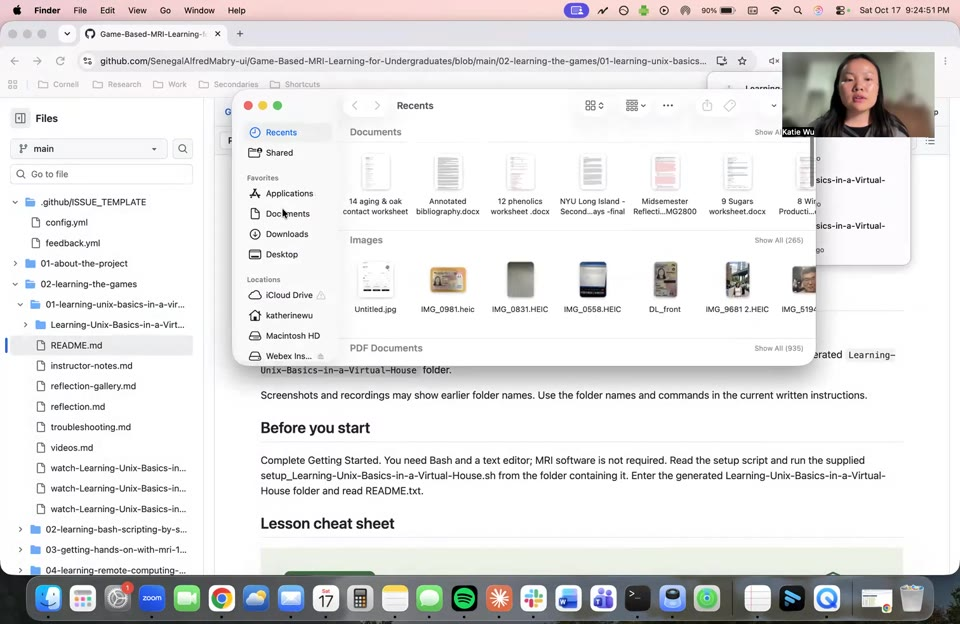
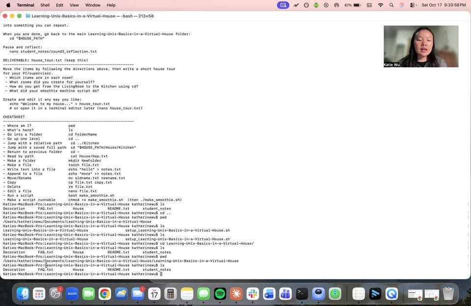
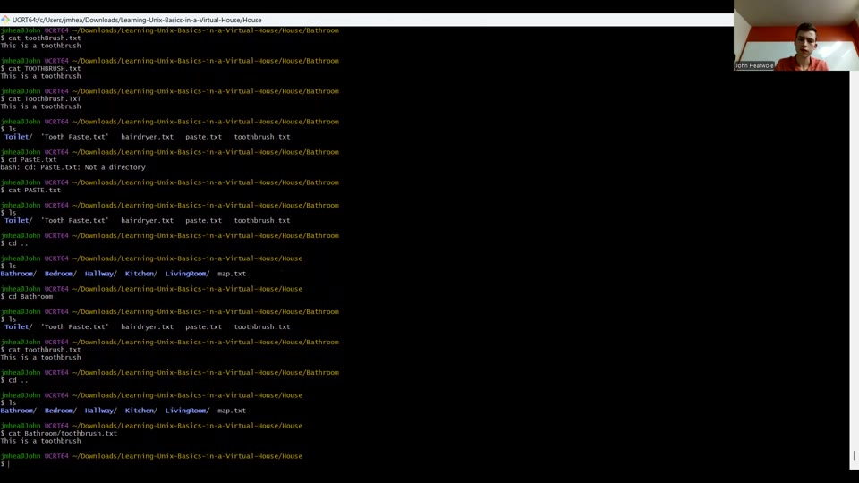
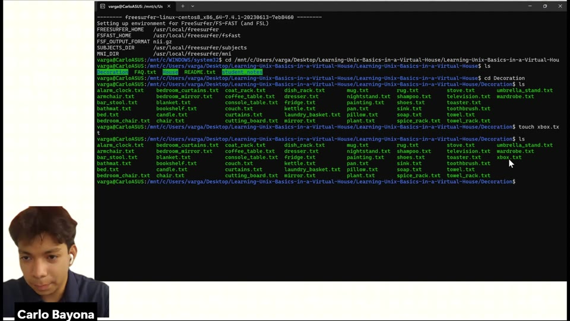
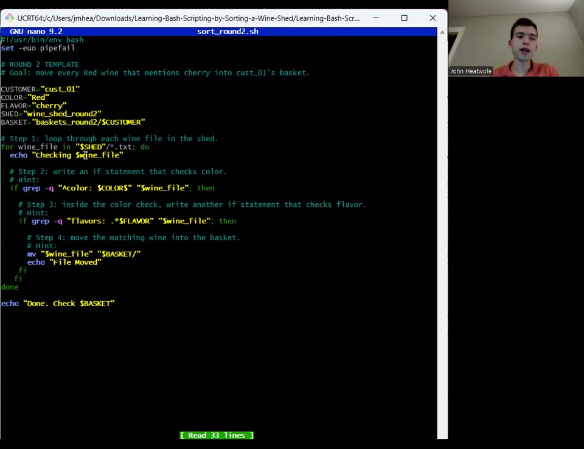
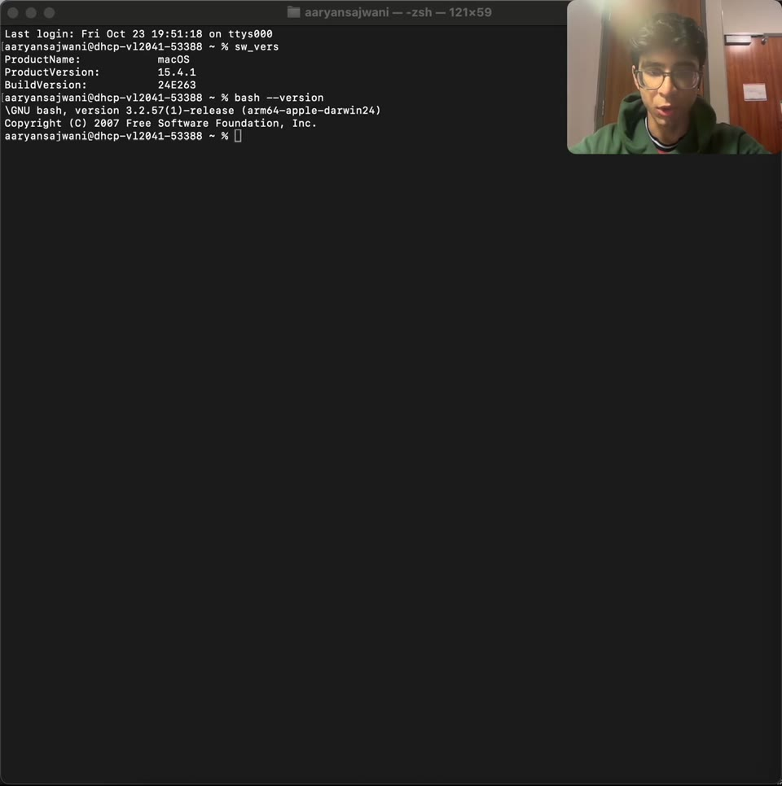
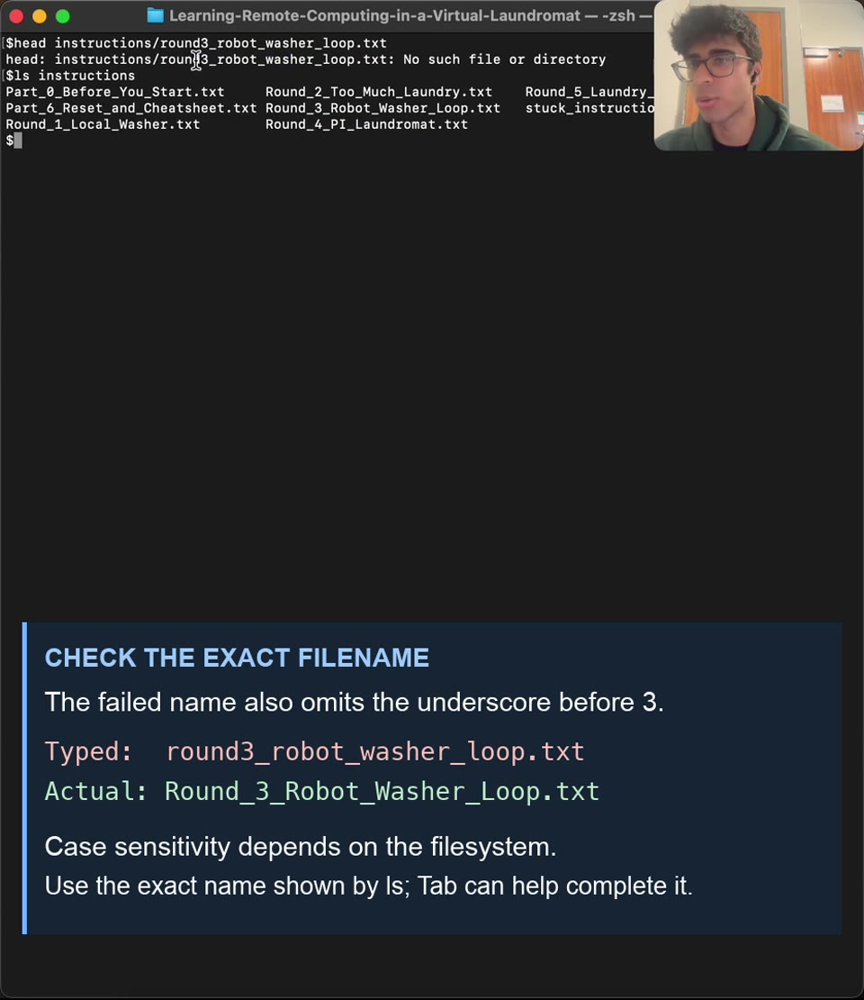

# Getting Started videos

Welcome to your first steps in MRI research. In the next five lessons, you will find downloaded folders, open text files, and learn how to understand error messages. You may already be familiar with finding folders and opening files by clicking through windows on your computer. Here, you will use Terminal, a program that lets you interact with your computer by typing commands. Working this way is common in MRI research, where commands help you organize scan files and run analyses.

Because Terminal may be unfamiliar, we created these Getting Started videos to introduce the skills through examples from the games, giving you a place to begin before working with brain images. You can follow along in your own lesson folder and return to a video whenever you need a reminder.

These videos were made by fellow students. Our amazing undergraduates Katie Wu, John Heatwole, Carlo Bayona, and Aaryan Sajwani guide you through these first steps in eight short videos. Alongside the written instructions, their demonstrations show you how to prepare a lesson, work in Terminal, and check what happened after you ran a command.

[Written Getting Started guide](getting-started.md)

### Getting started and finding support

Eight short videos, made by undergraduate contributors, introduce the computer skills used throughout the five lessons. **(A)** The topics cover preparing a lesson, working with files, running scripts, and checking results. **(B)** Reference sheets, troubleshooting guidance, and reflection prompts provide additional support, illustrated here with the smoothie-script task from *Learning Unix Basics in a Virtual House*.

[Open full-size figure](../assets/figures/Figure-1a-Course-Materials-and-Support.png) · [Download PDF](../assets/figures/Figure-1a-Course-Materials-and-Support.pdf) · [Download SVG](../assets/figures/Figure-1a-Course-Materials-and-Support.svg)

## Find your way around the project

Katie Wu · 2:37 · Project orientation

Katie welcomes you to the project with a tour of the materials for each lesson. She walks you through the game downloads, command references, and troubleshooting pages, then shows you where to watch other students’ reflections.

[Watch video](watch-G1-Find-Your-Way-Around-the-Project.md) · [Transcript draft](../assets/transcripts/G1-Find-Your-Way-Around-the-Project.md)

## Download and set up a lesson

Katie Wu · 2:04 · macOS example

Ready to try the first game? Follow Katie as she downloads and sets up Learning Unix Basics in a Virtual House. She takes you through unpacking the files, running the setup script in Terminal, and opening the README so you can begin the first lesson.

[Watch video](watch-G2-Download-and-Set-Up-a-Lesson.md) · [Transcript draft](../assets/transcripts/G2-Download-and-Set-Up-a-Lesson.md)

## Navigate Terminal and find your files

Katie Wu · 2:25 · macOS example

With your lesson downloaded, join Katie in Terminal to find the files you will use. She demonstrates how to check which folder you are in, see what it contains, and move between folders using `pwd`, `ls`, and `cd`.

[Watch video](watch-G3-Navigate-Terminal-and-Find-Your-Files.md) · [Transcript draft](../assets/transcripts/G3-Navigate-Terminal-and-Find-Your-Files.md)

## Relative and absolute paths

John Heatwole · 3:38 · Windows MSYS2 example

John introduces two ways to reach a file: relative and absolute paths. He explains where each path begins and demonstrates how to work with names that contain spaces. These examples will help you move around your lesson folders without losing track of where you are.

[Watch video](watch-G4-Relative-and-Absolute-Paths.md) · [Transcript draft](../assets/transcripts/G4-Relative-and-Absolute-Paths.md)

## Read, edit, and save a text file

Carlo Bayona · 3:48 · Windows WSL example

Create your first text file alongside Carlo as he introduces nano, a text editor you can use in Terminal. He adds text, saves the file, and opens it with `cat` to check the contents. You will use these same steps when editing files and completing scripts in the games.

[Watch video](watch-G5-Read-Edit-and-Save-a-Text-File.md) · [Transcript draft](../assets/transcripts/G5-Read-Edit-and-Save-a-Text-File.md)

## Run a Bash script and check its output

John Heatwole · 4:39 · Windows MSYS2 example

Next, put a script to work with John using an example from the Wine Shed. He explains the commands it contains, runs it, and checks the customer basket to see which wine files were moved.

[Watch video](watch-G6-Run-a-Bash-Script-and-Check-Its-Output.md) · [Transcript draft](../assets/transcripts/G6-Run-a-Bash-Script-and-Check-Its-Output.md)

## Check the tools for your lesson

Aaryan Sajwani · 3:13 · macOS example

Before starting a lesson, check that your computer has the tools it needs. Aaryan takes you through those checks. He checks Bash and Python, locates dcm2niix, and opens an MRI viewer. Follow your lesson’s software instructions to see which of these tools you will need.

[Watch video](watch-G7-Check-the-Tools-for-Your-Lesson.md) · [Transcript draft](../assets/transcripts/G7-Check-the-Tools-for-Your-Lesson.md)

## Work through an error and ask for help

Aaryan Sajwani · 4:42 · macOS example using Lesson 4

An error message can help you decide what to check next. Aaryan works through an example from the Virtual Laundromat. He reads the error, checks his current folder, and corrects a filename. He also shows you where to find the troubleshooting instructions when you need more help.

[Watch video](watch-G8-Work-Through-an-Error-and-Ask-for-Help.md) · [Transcript draft](../assets/transcripts/G8-Work-Through-an-Error-and-Ask-for-Help.md)
