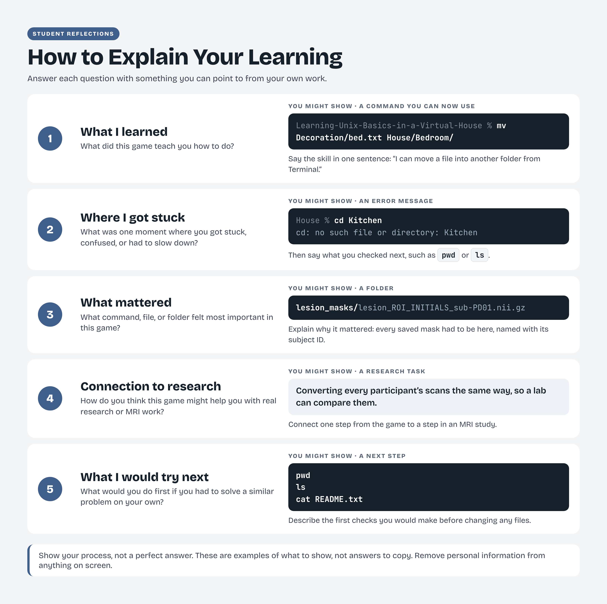
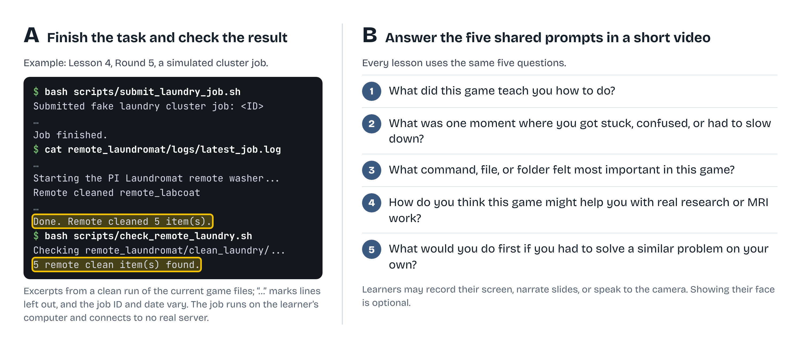
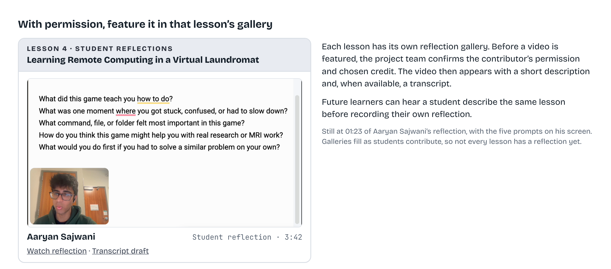

# Student reflections

## Learning through reflection

As you work through a lesson, you may find that some steps make sense right away and others take a few attempts. In these reflection videos, undergraduate contributors share their own experiences with the games, including what confused them and what helped them move forward. You can find each video in the reflection gallery for its lesson. After watching, consider how their experience compares with yours and what you would try differently next time.

Each lesson has its own reflection-video gallery. After completing the activity, use the five shared questions below to prepare a video about your experience. You can record your screen, narrate slides, or speak to the camera. Showing your face is optional.

A reflection connects the task you completed with the decisions you made, the difficulties you worked through, and the steps you would take in future research.

[Download a printable PDF](../assets/figures/Game-Based-MRI-Learning-for-Undergraduates-Reflection-Guide.pdf)

Examples to discuss include moving a file with `mv Decoration/bed.txt House/Bedroom/`, checking an unexpected folder error with `pwd` and `ls`, and explaining how the subject identifier connects a mask in `lesion_masks/` to the correct scan. For a future task, describe what you would check with `pwd`, `ls`, and `cat README.txt` before changing files. These are illustrative examples; describe your own work and remove personal information from anything you show. Error wording varies between shells.

## Prepare your reflection video

Explain the work in your own words and use an example from your attempt when it helps. You might show a command, an output folder, or a step you checked carefully. Record only the lesson materials and remove personal information from anything visible on screen. Share the recording with your instructor or the project team through the agreed contribution route.

Publication in a lesson gallery is a separate step from recording a reflection for your instructor. The project team will confirm the display credit, description, and permission to feature the video before adding it to the gallery.

### From completing a task to reflecting on it

Reflection begins with examining what happened during the lesson. **(A)** A worked example from *Learning Remote Computing in a Virtual Laundromat* shows how a learner checks a simulated job’s log and output files. **(B)** Five shared prompts invite students to describe what they learned, where they encountered difficulty, which tools mattered, and how they might approach similar work in MRI research.

[Open full-size figure](../assets/figures/Figure-3a-Finish-the-Task-and-Answer-the-Prompts.png) · [Download PDF](../assets/figures/Figure-3a-Finish-the-Task-and-Answer-the-Prompts.pdf) · [Download SVG](../assets/figures/Figure-3a-Finish-the-Task-and-Answer-the-Prompts.svg)

## Five shared questions

What did this game teach you how to do?

What was one moment where you got stuck, confused, or had to slow down?

What command, file, or folder felt most important in this game?

How do you think this game might help you with real research or MRI work?

What would you do first if you had to solve a similar problem on your own?

### Learning from other students’ reflections

Each lesson has its own reflection-video gallery, where students describe their experiences in their own words. This example features Aaryan Sajwani’s reflection on *Learning Remote Computing in a Virtual Laundromat*. Videos are featured with the contributor’s permission and chosen credit, alongside a description and, when available, a transcript.

[Open full-size figure](../assets/figures/Figure-3b-Share-in-the-Lesson-Gallery.png) · [Download PDF](../assets/figures/Figure-3b-Share-in-the-Lesson-Gallery.pdf) · [Download SVG](../assets/figures/Figure-3b-Share-in-the-Lesson-Gallery.svg)

## Corrections and featuring

Each published reflection appears in the gallery for its lesson, with the contributor’s chosen display credit, a short description, and a transcript when available. To correct a description or request removal of a featured video, contact the project maintainer.

For reflection contributions, contact [Senegal Alfred Mabry](mailto:sam469@cornell.edu) to arrange delivery of the recording.

- [Lesson 1 — Learning Unix Basics in a Virtual House](../02-learning-the-games/01-learning-unix-basics-in-a-virtual-house/reflection-gallery.md)
- [Lesson 2 — Learning Bash Scripting by Sorting a Wine Shed](../02-learning-the-games/02-learning-bash-scripting-by-sorting-a-wine-shed/reflection-gallery.md)
- [Lesson 3 — Getting Hands-On with MRI #1: Converting DICOM to NIfTI](../02-learning-the-games/03-getting-hands-on-with-mri-1-converting-dicom-to-nifti/reflection-gallery.md)
- [Lesson 4 — Learning Remote Computing in a Virtual Laundromat](../02-learning-the-games/04-learning-remote-computing-in-a-virtual-laundromat/reflection-gallery.md)
- [Lesson 5 — Getting Hands-On with MRI #2: Lesion Identification in Parkinson’s Disease Research Through Brain Image Analysis](../02-learning-the-games/05-getting-hands-on-with-mri-2-lesion-identification-in-parkinsons-disease-research-through-brain-image-analysis/reflection-gallery.md)
