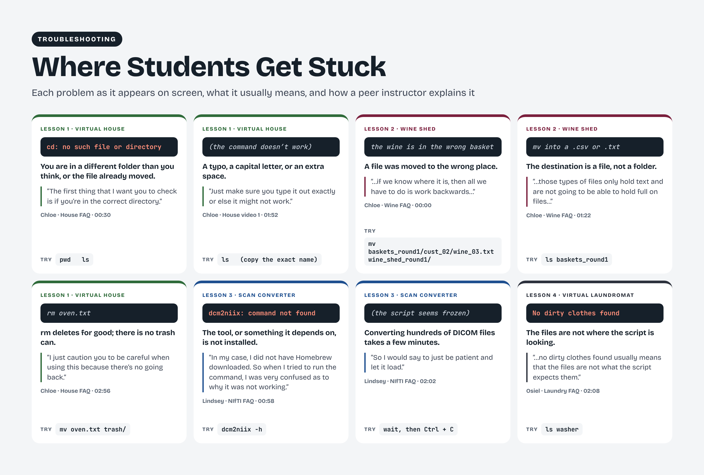

# For instructors and laboratory mentors

## Teaching with the curriculum

You may hear from many undergraduates eager to contribute to your research, or you may already have students preparing to join your laboratory. We hope these activities give them a practical first step toward participating in your workflow. Students learn to navigate files, write short scripts, convert MRI scans, organize repeated processing, and inspect brain images. Their saved files, scripts, and explanations give you concrete work to review as you help them connect these skills to your laboratory’s questions.

Students can work through the lessons asynchronously, but we ask instructors and mentors to remain involved. New tools and unfamiliar errors can make this work challenging. Arrange check-ins, identify someone students can approach for help, and discuss their results before they move on. Before assigning a lesson, run it in the environment students will use and check its downloads, software, instructions, and expected outputs.

## Facilitation

To connect learning through the games with the work of your laboratory, begin by showing students a research task that uses the same skill. A folder-navigation exercise can lead into your study’s directory structure; a sorting loop can lead into selecting scans for processing. When a student gets stuck, ask them to identify the input, the action they intended, and the output they expected. Work through an example together, then let them try the next step and explain the result.

## Guidance for mentoring and evaluating lesson work
These checks support mentoring conversations and review of saved work. They are separate from the five shared prompts used for reflection videos.

Lesson 1: Listen for the distinction between a file and a folder, a relative and an absolute path, and reading a script versus running it. Check the smoothie’s contents as well as whether a script executed.

Lesson 2: Ask students to explain both matching conditions and how the loop handles more than one input. Check an order against its basket and discuss how changed inputs test the script’s assumptions.

Lesson 3: Ask students to distinguish the scan series, conversion program, image file, and metadata. Compare the GUI and script outputs. Avoid treating the act of opening an overlay as a registration check.

Lesson 4: Ask students to identify where inputs and outputs reside and how they know a job finished. Make the simulated server and scheduler explicit before discussing institutional systems.

Lesson 5: Discuss subject identity, image quality, annotation decisions, mask labels, units, and incomplete data. Compare how different marking choices could affect a descriptive summary. Keep the scientific interpretation within the scope of the teaching exercise.

Examples from the instructional recordings show problems students may encounter while navigating files, writing commands, and converting scans. Each example pairs the problem with a peer instructor’s explanation and a practical check to try. These examples illustrate the support materials rather than the frequency of errors among learners.

## Assessment

Review students’ completed work with them and ask how they know it is correct. A useful check combines the output with the student’s explanation: which inputs were used, what the command or script did, what they inspected, and what they changed when a problem appeared. This discussion can take place during a mentoring check-in or a separate assignment.

The lesson-specific guidance above is for reviewing the activity itself. Reflection videos complement that review by showing how students describe their learning, difficulties, and next steps. Use the five shared prompts for the video; the technical checks are not additional video questions or a required recording script. Give feedback on the connection between a student’s explanation and their saved work, and agree on any steps to revisit before advancing.

## Adapting the activities

You can change the setting of a file-sorting exercise or select a subset of lessons while preserving the skills being taught. Review prerequisites before skipping a lesson. Provide a managed environment or additional setup support where needed. Keep adaptations accessible through written instructions and clearly describe changes to filenames, commands, and expected outputs.

## Public solutions

Instructor notes and solutions are available to students as well as teachers. They can support checking and discussion after an attempt. Ask students to explain how a solution works and where it would need to change for a different input.

## Preparing reflection thumbnails

Use the [reflection thumbnail template](../assets/figures/Game-Based-MRI-Learning-for-Undergraduates-Reflection-Thumbnail-Template.png) when preparing an approved recording for a lesson gallery. An [editable HTML version](../assets/figures/Game-Based-MRI-Learning-for-Undergraduates-Reflection-Thumbnail-Template.html) is available: download it, replace the placeholder with a frame from the recording, and change the lesson number, title, and color. The HTML version loads its typefaces from Google Fonts when online. Keep the contributor’s credit, duration, and watch/transcript links in the gallery text. The template is a design resource and should not appear as a video awaiting playback.
