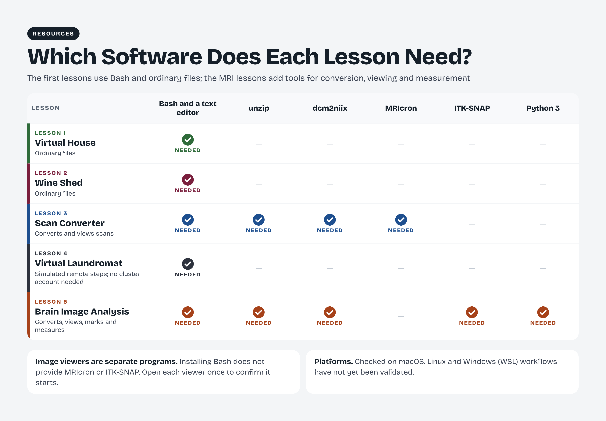

# Resources

## Software

The first computing activities use Bash and ordinary files. The MRI activities add tools for conversion, image viewing, and measurement.

[Download a printable PDF](../assets/figures/Game-Based-MRI-Learning-for-Undergraduates-Software-by-Lesson.pdf)

Lesson 1, Lesson 2, and Lesson 4 use Bash and ordinary files. Lesson 3 adds unzip, dcm2niix, and MRIcron. Lesson 5 uses unzip, dcm2niix, ITK-SNAP, and Python 3. Use the installation route appropriate to your computer and confirm the program’s version before starting the lesson.

The unzip command is used to unpack the internal scan archives in Lessons 3 and 5. Use your file browser to extract the main lesson downloads. Lesson 4 simulates remote computing locally and does not require a cluster account. Image viewers are separate programs; open the viewer required for your lesson to confirm that it starts.

## Command reference

pwd prints the current directory. ls lists directory contents. cd changes directories. cat prints text from a file. nano opens a text editor. mkdir creates a directory. cp copies files, mv moves or renames them, and rm removes them.

grep searches text for a pattern. A variable stores a value that a script can reuse. A condition controls whether an action runs. A loop repeats actions over inputs. A wildcard matches filenames, and redirection sends output into a file. Inspect the matched inputs and destination before running a command that changes files.

bash runs a shell script. chmod changes permissions. dcm2niix converts DICOM series into NIfTI images and can write JSON metadata. The simulated remote commands in Lesson 4 illustrate computing concepts within the local lesson; actual remote systems require institution-specific instructions.

## Teaching data

The MRI lessons use teaching scans to introduce conversion, image review, and manual annotation. The capstone contains six teaching subjects with MPRAGE and FLAIR scans and group labels for the exercise. Keep each subject’s images, masks, and measurements associated with the correct identifier.

## Accessibility

Written instructions accompany the lessons, figures include text descriptions, and video transcripts provide a readable companion to the recordings. Reflection videos may use screen recordings or narrated slides; students do not need to show their faces. Contact the instructor or maintainer if you need an accommodation to participate.

If a format or activity creates an access barrier, contact the maintainer to discuss an alternative. Report the page or lesson and the type of difficulty without including private medical information in a public post.

## Cite this project

Cite this curriculum as: Mabry, Senegal Alfred. *Game-Based MRI Learning for Undergraduates*. Version 0.1.0, 2026. [Repository](https://github.com/SenegalAlfredMabry-ui/Game-Based-MRI-Learning-for-Undergraduates). This is a repository citation; the associated manuscript citation will be added separately.

When referring to a particular version of the teaching materials, cite the corresponding release. When describing the associated research, cite the paper as well. A release identifies the materials used even as the repository continues to develop.

Maintainer: [Senegal Alfred Mabry](mailto:sam469@cornell.edu).

Official software resources: [Bash](https://www.gnu.org/software/bash/), [dcm2niix](https://github.com/rordenlab/dcm2niix), [MRIcron](https://www.nitrc.org/projects/mricron), [ITK-SNAP](https://www.itksnap.org/), [Python](https://www.python.org/), [WSL](https://learn.microsoft.com/windows/wsl/).

MRI data are supplied by Senegal Alfred Mabry for this teaching project, which has IRB approval. Contact the maintainer for reuse beyond this project; the code and teaching-text licenses do not apply to the scans.

The current materials have been checked on macOS. Linux and Windows/WSL workflows require further validation before classroom deployment.

## Figures and reference sheets

Browse the [complete figure collection](../assets/figures/README.md) for captions, lesson placement, printable PDFs, and the workflow animations. Each lesson also displays its own cheat sheet.
