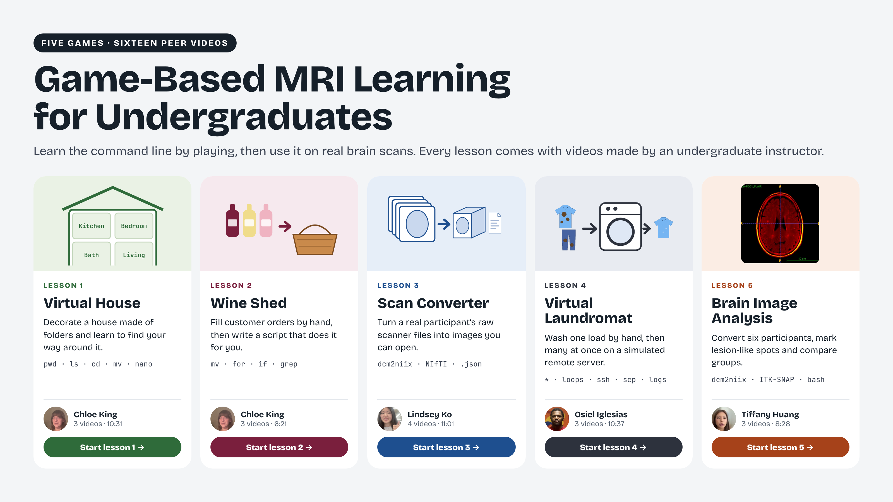

# Game-Based MRI Learning for Undergraduates

## Making MRI Research More Accessible Through Hands-On Learning.

Magnetic resonance imaging (MRI) is an increasingly important tool for understanding the human brain, from studying emotion and cognition to investigating neurological conditions such as Parkinson's disease. However, using MRI to make meaningful scientific discoveries and deepen our understanding of cognition and brain health requires more than knowledge of neuroscience alone. Researchers must also be adept at navigating computer systems, organizing and manipulating data, writing scripts, and using specialized software to process and analyze brain images. For undergraduates passionate about learning neuroscience and interested in working with MRI, even opening Terminal can feel daunting when they have little experience with programming or the computational tools used in research.

This project, Game-Based Learning for Hands-On Magnetic Resonance Imaging Education in Undergraduates, introduces a series of five game-based learning experiences, developed with undergraduate students, to make these technical skills more accessible. Each game transforms a foundational neuroimaging skill into a practical challenge, giving students an opportunity to learn by doing rather than simply following instructions.

Students begin by building a virtual house using Unix commands, then organize wine orders with Bash scripts, convert actual MRI scans from DICOM to NIfTI, and explore remote computing through a virtual laundromat. In the final game, students bring these skills together to examine brain images and explore lesion identification in the context of Parkinson's disease research.

Together, these games offer an introduction to the computational side of neuroimaging, helping students build the skills and confidence to take their first steps into MRI research.

The five lessons introduce file navigation, scripting, MRI conversion, simulated remote computing, and brain image analysis. Use the lesson pages for the full video collection, including supplemental walkthroughs and student reflections.

## Start learning

[Getting started](02-learning-the-games/getting-started.md) · [About](01-about-the-project/README.md) · [For instructors](04-for-instructors/README.md) · [Resources](05-resources/README.md) · [Licensing](LICENSES/README.md)

Before you begin the five lessons, Getting Started introduces the computer skills you will use along the way. You may already know how to find a folder or open a file by clicking on your computer. Here, you will practice doing these tasks in Terminal, a program that lets you interact with your computer by typing commands. Because Terminal may be unfamiliar, we created eight short videos to accompany the written instructions. Made by fellow students, these demonstrations help you get your lesson files ready. Begin with these examples, then use what you learn as you work through the games and start exploring MRI data.

[Watch the Getting Started tutorials](02-learning-the-games/getting-started-videos.md).

The lessons and recordings are publicly available. Downloading the lessons does not require a GitHub account; submitting feedback through GitHub does. Feedback and the submitting GitHub username are public.

## The five lessons

[Lesson 1 — Learning Unix Basics in a Virtual House](02-learning-the-games/01-learning-unix-basics-in-a-virtual-house/README.md). Navigate folders, move and edit files, and write your first short script.

[Lesson 2 — Learning Bash Scripting by Sorting a Wine Shed](02-learning-the-games/02-learning-bash-scripting-by-sorting-a-wine-shed/README.md). Use file contents, conditions, and loops to sort orders and repeat a task.

[Lesson 3 — Getting Hands-On with MRI #1: Converting DICOM to NIfTI](02-learning-the-games/03-getting-hands-on-with-mri-1-converting-dicom-to-nifti/README.md). Convert MRI scans through a graphical interface and a script, then inspect the outputs.

[Lesson 4 — Learning Remote Computing in a Virtual Laundromat](02-learning-the-games/04-learning-remote-computing-in-a-virtual-laundromat/README.md). Practice batch processing, file transfer, job submission, and checking results in a local simulation.

[Lesson 5 — Getting Hands-On with MRI #2: Lesion Identification in Parkinson’s Disease Research Through Brain Image Analysis](02-learning-the-games/05-getting-hands-on-with-mri-2-lesion-identification-in-parkinsons-disease-research-through-brain-image-analysis/README.md). Combine conversion, image inspection, manual marking, measurement, and descriptive group comparison.

## Learn with other students

Each lesson has its own reflection-video gallery. Watch students describe what they learned, where they had questions, and how they would approach similar work again. After completing a lesson, prepare your own reflection video to explain what you learned and how it connects to the research you hope to do.

## For instructors and researchers

Instructors and laboratory mentors will find learning objectives, facilitation notes, suggestions for evaluating students’ work, and adaptations. Teaching materials and solutions are included in this repository. The About section explains the curriculum’s rationale and its relationship to our project manuscript.

## Get help

[Submit text feedback](https://github.com/SenegalAlfredMabry-ui/Game-Based-MRI-Learning-for-Undergraduates/issues/new?template=feedback.yml)

If you are stuck, please start with the troubleshooting page for your lesson. The command reference explains common Terminal commands, and the software guide lists the tools used in each activity. If you report a problem, include the lesson, step, command, and error message. Remove personal paths or identifying information before posting.

## Cite and reuse

Please cite this curriculum when using or adapting it. Citation details appear in [Cite This Project](05-resources/README.md#cite-this-project). Code is offered under the MIT License, and original teaching text and figures under CC BY 4.0, subject to the scope and exceptions in the licensing notice. Student recordings and MRI data have separate terms.
